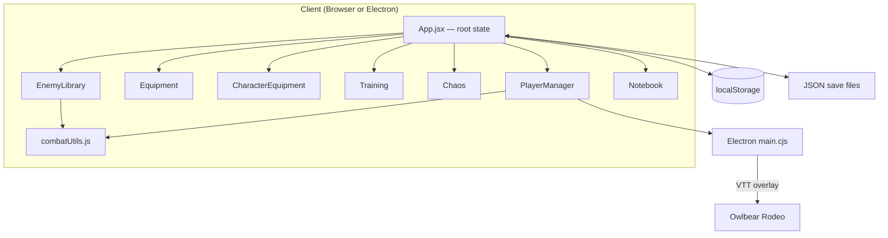

# RPG Party Manager — Architecture

A desktop-first web application for running D&D 5e-style homebrew campaigns. It replaces an older Excel macro workbook (`Party Manager 2.7.xlsm`) with a React single-page app, optional Electron wrapper, and a large structured monster bestiary.

---

## Table of Contents

1. [Project Overview](#project-overview)
2. [Origin & Migration](#origin--migration)
3. [Technology Stack](#technology-stack)
4. [Repository Layout](#repository-layout)
5. [Application Architecture](#application-architecture)
6. [State & Persistence](#state--persistence)
7. [Data Models](#data-models)
8. [Feature Modules](#feature-modules)
9. [Combat Engine](#combat-engine)
10. [Homebrew Rules](#homebrew-rules)
11. [UI & Theming](#ui--theming)
12. [Electron & VTT Integration](#electron--vtt-integration)
13. [Legacy & Reference Assets](#legacy--reference-assets)
14. [Development Workflow](#development-workflow)
15. [Known Gaps & Future Work](#known-gaps--future-work)

---

## Project Overview

**RPG Party Manager** is a Dungeon Master tool for a specific homebrew table. It centralizes:

- **Party roster** — HP, mana, XP, conditions, buffs, and battle mode
- **Inventory & equipment** — per-player bags, gold, and a paper-doll equip screen
- **Bestiary** — 800+ pre-built monsters with parsed attacks, plus custom entries
- **Combat resolution** — enemy attacks against players with damage modifiers, saves, and CC
- **Training tracker** — stat-based progression mini-game
- **Chaos tables** — random event rollers (Magic Fumble, Wild Magic, Weather, custom)
- **Notebook** — quest log and lore notes

There is **no backend server**. All data lives in the browser (`localStorage`) or in exported JSON save files.



---

## Origin & Migration

The project evolved from a **VBA-powered Excel workbook**:

| Legacy (Excel) | Modern (Web) |
|---|---|
| `Party Manager 2.7.xlsm` | `webapp/` React app |
| VBA modules (`macros.txt`) | `PlayerManager.jsx`, `combatUtils.js` |
| Excel sheets for players/enemies | JSON objects in `localStorage` |
| UserForms (e.g. `AttackMenu.frm`) | In-app modals and battle arena UI |
| Creature lookup functions | `default_monsters.json` + `EnemyLibrary` |

### Migration artifacts at repo root

| File | Purpose |
|---|---|
| `extract.py` | Python script using `oletools.olevba` to extract VBA from the `.xlsm` into `macros.txt` |
| `macros.txt` | Full exported VBA source (~4,900 lines) — reference for original logic |
| `real_party_data.json` | Snapshot of real campaign party stats (used during migration/testing) |
| `sample-party-save.json` | Example export format for the web app |
| `db_anomalies_fixed_report.json` | Audit log of bestiary parsing fixes (e.g. breath weapons with "Recharge 5–6") |
| `run.bat` | Windows shortcut: opens browser + starts Vite dev server |

The Excel file itself is **not** in the repository; only its extracted macros and derived data remain.

---

## Technology Stack

| Layer | Choice | Notes |
|---|---|---|
| UI framework | **React 19** | Functional components + hooks |
| Build tool | **Vite 7** | Fast HMR; `base: './'` for Electron file loading |
| Language | **JavaScript (JSX)** | No TypeScript |
| Styling | **Plain CSS** | Per-component `.css` files + global design tokens in `index.css` |
| Desktop shell | **Electron 41** | Optional; loads Vite dev URL or built `dist/` |
| Packaging | **electron-packager** | Builds `PartyManager` Windows x64 binary |
| Persistence | **localStorage + JSON files** | No database |
| Linting | **ESLint 9** | React hooks + refresh plugins |

### npm scripts (`webapp/package.json`)

| Script | Command | Purpose |
|---|---|---|
| `dev` | `vite` | Web-only development at `http://localhost:5173` |
| `build` | `vite build` | Production bundle → `webapp/dist/` |
| `preview` | `vite preview` | Preview production build |
| `electron:dev` | Vite + Electron concurrently | Full desktop dev experience |
| `electron:build` | Build + packager | Creates `dist-electron/PartyManager-win32-x64/` |

---

## Repository Layout

```
RPG-Party-Manager/
├── architecture.md          ← this file
├── extract.py               ← VBA extraction utility
├── macros.txt               ← exported Excel VBA source
├── real_party_data.json     ← campaign data snapshot
├── sample-party-save.json   ← example save file
├── db_anomalies_fixed_report.json
├── run.bat                  ← quick dev launcher (Windows)
│
└── webapp/                  ← main application
    ├── index.html
    ├── package.json
    ├── vite.config.js
    ├── eslint.config.js
    │
    ├── electron/
    │   └── main.cjs         ← Electron entry + Owlbear VTT overlay
    │
    ├── public/              ← static assets (sprites, backgrounds)
    │   ├── bio_background.png
    │   ├── body-silhouette.png
    │   └── sprites/         ← class/enemy portrait PNGs
    │
    ├── Documents/           ← reference PDFs + raw monster TSV
    │   ├── default monster list.txt
    │   ├── Monster Manual.pdf
    │   └── Volo's Guide to Monsters.pdf
    │
    └── src/
        ├── main.jsx         ← React entry point
        ├── App.jsx          ← root component, global state, navigation
        ├── App.css
        ├── index.css        ← design system / themes
        │
        ├── utils/
        │   └── combatUtils.js   ← dice, parsing, AC, damage/CC math
        │
        └── components/
            ├── PlayerManager.jsx / .css     ← party + battle mode (largest file)
            ├── Equipment.jsx / .css           ← shared inventory
            ├── CharacterEquipment.jsx / .css  ← paper-doll equip UI
            ├── EnemyLibrary.jsx / .css      ← bestiary + buff DB editor
            ├── Training.jsx / .css
            ├── Chaos.jsx / .css
            ├── Notebook.jsx / .css
            ├── EncounterBuilder.jsx / .css  ← legacy/unused component
            └── default_monsters.json        ← ~800 built-in monsters (~63k lines)
```

---

## Application Architecture

### Entry flow

1. `index.html` mounts `#root`
2. `main.jsx` renders `<App />` inside `StrictMode`
3. `App.jsx` owns all persistent game data and routes tabs via bottom navigation

### Component hierarchy

```
App
├── PlayerManager      (tab: players)   — roster, battle mode, enemies, attacks
├── Notebook           (tab: notebook)  — quest/notes pages
├── Equipment          (tab: inventory) — per-player item lists + gold
├── CharacterEquipment (tab: charequip) — equip slots + wondrous items
├── Training           (tab: training)  — training progress per player
├── Chaos              (tab: chaos)      — random table roller
└── EnemyLibrary       (tab: bestiary)  — monster DB, buffs, item templates
```

### State management pattern

There is **no Redux, Zustand, or React Context**. State follows a simple **lifted-state** pattern:

- `App.jsx` holds canonical `data` object and passes slices + updaters to children
- Children call `updateData('players', newPlayers)` or equivalent callbacks
- Battle-specific ephemeral state (`enemies`, `battleMode`, `minimizedEnemies`) lives in `App.jsx` but persists separately in `localStorage`
- UI-only state (modals, expanded cards, edit drafts) stays local inside each component

### Data flow example (damage during combat)

```
Enemy attack selected in PlayerManager
  → executeAttack() rolls dice via combatUtils
  → applies HP/Temp HP/CC changes to player objects
  → updateData('players', updatedPlayers) in App
  → useEffect persists to localStorage
```

---

## State & Persistence

### localStorage keys

| Key | Content |
|---|---|
| `partyManagerData` | Main save: players, equipment, library, training, chaos, notebook, buffs, bestiaryReview |
| `partyManagerConfig` | Theme, UI scale, startup view, fullscreen, default roll mode |
| `partyManagerEnemies` | Active encounter enemies (battle mode) |
| `partyManagerMinimizedEnemies` | `{ enemyId: boolean }` collapse state |
| `partyManagerBattleMode` | `"true"` / `"false"` |
| `partyManagerLastTab` | Last visited nav tab |
| `isVttOpen` | VTT panel visibility |
| `vttRoomUrl` | Owlbear room URL |
| `battleNotes` | DM scratchpad in battle mode |

### Save / load

- **Auto-save**: every change to `data` triggers `localStorage.setItem('partyManagerData', ...)`
- **Export**: bottom nav downloads `party-manager-save-{timestamp}.json`
- **Import**: merges uploaded JSON over `DEFAULT_DATA` defaults (preserves new default buffs/library entries)
- **Merge strategy**: on load, missing keys are filled from `DEFAULT_DATA`; new default buffs are appended if absent

### Root data shape (`App.jsx` → `DEFAULT_DATA`)

```javascript
{
  players: Player[],
  equipment: {
    inventories: { [playerId]: InventoryItem[] },
    equipped:    { [playerId]: EquippedSlots },
    playerGold:  { [playerId]: number }
  },
  library: Monster[],           // user-created/custom monsters
  encounters: [],               // reserved; EncounterBuilder unused
  training: { [playerId]: TrainingEntry[] },
  chaos: { customTables: ChaosTable[] },
  notebook: { pages: NotebookPage[] },
  bestiaryReview: { [monsterName]: reviewState },
  buffsDatabase: Buff[]
}
```

---

## Data Models

### Player

Core roster character. Stored in `data.players[]`.

```javascript
{
  id: string,                    // unique ID (timestamp-based)
  name: string,
  player?: string,               // real-world player name
  classType: string,
  xp: number,                    // drives level via D&D 5e thresholds
  inParty: boolean,              // visible in party / training views
  hpBase: number,                // base HP before CON scaling
  hpCurrent: number,
  hpTemp?: number,               // temporary HP (D&D rules)
  manaBase?: number,
  manaCurrent: number,
  manaExhaustion?: number,
  ultMax: number,                // homebrew "limit break" meter max
  ultCurrent: number,
  ac: number,                    // base AC when no armor equipped
  proficiencyBonus?: number,
  passivePerception?: number,
  str, dex, con, int, wis, cha: number,
  race, alignment, background, features: string,
  skills: { [skillName]: boolean },
  saves?: { str?, dex?, con?, int?, wis?, cha? },
  resistances, immunities, vulnerabilities: string[],   // damage types
  ccResistances, ccImmunities, ccVulnerabilities: string[],
  cc: string[],                  // active conditions (emoji labels)
  buffs: string[],               // buff names referencing buffsDatabase
  buffStates?: { [buffName]: boolean },  // toggle buff on/off
  spentBuffs?: { [buffName]: boolean }   // once-per-rest tracking
}
```

**Derived values** (computed in UI, not stored):

- Level from `xp` using standard 5e threshold table (levels 1–20)
- Max HP = `hpBase + (CON mod × level)`
- Max mana from level + INT/WIS/CHA multipliers
- Effective AC via `calculateEffectiveAC()` in `combatUtils.js`

---

### InventoryItem

Stored in `equipment.inventories[playerId][]`.

```javascript
{
  id: string,
  name: string,
  description: string,
  quantity: number,
  weight: string,
  type: string,        // 'head'|'neck'|'armor'|...|'wondrous'|'other'|'Consumables'|etc.
  rarity: string,        // Common → Mythic/Artifact
  modifiers: { str, dex, con, int, wis, cha: number },  // additive stat mods
  setAttributes: { ... },  // override stat to fixed value
  acBonus: number,
  baseAC: number,        // for armor-type items
  acModifierStat: string,
  acModifierCap: number | null,
  resistances, immunities, vulnerabilities: string[],
  ccResistances, ccImmunities, ccVulnerabilities: string[],
  buffs: string[]
}
```

---

### EquippedSlots

Stored in `equipment.equipped[playerId]`.

```javascript
{
  head, neck, armor, mainHand, mainHand2,
  offhand, offhand2, waist, feet, gloves: SlotItem,
  __wondrous__: WondrousItem[]
}
```

Each slot item shares the same field shape as `InventoryItem` (minus quantity/weight). The `armor` slot replaces legacy `torso` naming.

---

### Monster (Bestiary entry)

Stored in `data.library[]` (custom) or `default_monsters.json` (built-in, read-only `isDefault: true`).

```javascript
{
  id: string,
  name: string,
  classType: 'Enemy' | 'Boss',
  ac: number,
  hpMax: number,
  hp?: number,
  str, dex, con, int, wis, cha: number,
  proficiency: number,
  background: string,    // e.g. "Humanoid, CR 0.25"
  cr?: string,
  features: string,
  abilities: string,     // raw stat-block text (fallback for attack parsing)
  skills: { [skillName]: boolean },
  saves: { [statAbbr]: boolean },
  resistances, immunities, vulnerabilities: string[],
  ccResistances, ccImmunities, ccVulnerabilities: string[],
  attacks: Attack[],       // structured attacks (preferred in combat)
  buffs?: string[],
  isDefault?: boolean      // true for bundled bestiary entries
}
```

---

### Attack

Used on monsters and parsed from ability text.

```javascript
{
  id?: string,
  name: string,
  description: string,
  toHit: number | null,       // null for save-based abilities
  dc: number | null,
  save: string | null,        // e.g. "Dexterity"
  damage: [{
    average: number,
    formula: string,          // e.g. "2d6+3"
    type: string              // damage type (lowercase in parser)
  }],
  halfOnSuccess?: boolean,
  cc?: string,                // standard CC label or ''
  ccCustom?: string,          // free-text CC when cc === 'custom'
  range?: boolean,
  reach?: boolean
}
```

If `attacks[]` is empty at runtime, `parseAbilities(enemy.abilities)` generates attacks on the fly.

---

### Active Enemy (Battle instance)

Stored separately in `partyManagerEnemies` (not inside `partyManagerData`).

Same fields as Monster, plus battle runtime state:

```javascript
{
  ...monsterFields,
  hp: number,              // current HP (alias of hpCurrent in UI)
  hpMax: number,
  hpBase?: number,
  cc: string[],
  buffs: string[],
  buffStates: {},
  spentBuffs: {},
  editing?: boolean,
  limitBreakUsed?: boolean,
  bossHpStart?: number     // Boss-type enemies only
}
```

---

### Buff / Debuff

Stored in `data.buffsDatabase[]`. Referenced by name from players, enemies, and items.

```javascript
{
  id: string,
  name: string,
  description: string,
  type: 'toggle' | 'turn' | 'fixed',
  oncePerRest: 'none' | 'short' | 'long',
  // Combat modifiers (all optional):
  additionalDamage: string,
  additionalAC: number,
  dodge: boolean,
  extraMovement: number,
  extraAction: boolean,
  savingThrowBonus: number,
  advantageAttack, disadvantageAttack: boolean,
  advantageSave, disadvantageSave: boolean,
  advantageSaveStats, disadvantageSaveStats: { str?, dex?, ... },
  // Turn-based effects:
  turnType: 'healHP' | ...,
  turnFormula: string       // e.g. "1d6"
}
```

---

### TrainingEntry

Stored in `data.training[playerId][]`.

```javascript
{
  id: string,
  name: string,
  stat: 'str'|'dex'|'con'|'int'|'wis'|'cha',
  goal: number,            // target progress (steps of 100)
  progress: number,
  lastRollDisplay: string  // human-readable last roll breakdown
}
```

Roll formula: `d100 rounded to nearest 10 + (statMod × 10)`.

---

### ChaosTable

Built-in tables are hardcoded in `Chaos.jsx`. Custom tables in `data.chaos.customTables[]`.

```javascript
{
  id: string,
  name: string,
  isDefault?: boolean,
  rows: [{
    id: string,
    min: number,
    max: number,
    event: string,
    description: string    // supports inline [NdM] dice tokens
  }]
}
```

---

### NotebookPage

Stored in `data.notebook.pages[]`.

```javascript
{
  id: string,
  title: string,
  content: string,
  type: 'quest' | 'note',
  createdAt: number        // Unix timestamp
}
```

---

### AppConfig

Stored in `partyManagerConfig`.

```javascript
{
  theme: 'dark' | 'bio',
  fullscreenOnStartup: boolean,
  startupView: 'last' | 'party-minimized' | 'party-expanded',
  uiScale: '100%' | '110%' | '120%',
  defaultRollMode: 'manual' | 'auto'
}
```

---

## Feature Modules

### PlayerManager (`~4,300 lines`)

The core of the app. Responsibilities:

| Area | Features |
|---|---|
| Roster | Add/remove players, expand/collapse cards, inline stat editing |
| Progression | XP bars, level display, party-wide XP awards, instant level-up |
| Resources | HP (with temp HP bar), mana, ultimate/limit break meters |
| Conditions | CC badges, buff management, rest buttons (short/long) |
| Battle mode | Split layout: party column + enemy panel + optional VTT column |
| Enemies | Spawn from bestiary, manual edit, copy, HP tracking, boss limit break |
| Combat | Attack targeting modal, auto/manual roll modes, damage application |
| Settings | Config modal triggered from App (passed as prop) |

Class sprites load from `/sprites/{classType}.png` with fallback to `default.png`.

### Equipment

Per-player accordion inventory lists. Supports sorting, gold tracking, item CRUD, equipping to slots, and attaching buffs to items. Merges wondrous items from the equip screen into the inventory view.

### CharacterEquipment

Visual paper-doll (silhouette overlay) with 10 equipment slots + unlimited wondrous items. Each slot opens an editor for full item stats and resistances.

### EnemyLibrary

Three sub-tabs:

1. **Bestiary** — browse/search `default_monsters.json` + custom `library`; edit stat blocks; structured attack editor; preview rollers
2. **Buffs** — CRUD for `buffsDatabase`
3. **Items** — reusable item templates (stored in component state / library extensions)

Monsters marked `isDefault: true` cannot be deleted; copies become editable custom entries.

### Training

Grid of party members with independent training tracks. Progress bars and d100-based roll button per entry.

### Chaos

Rolls d100 against table row ranges. Default tables: Magic Fumble, Wild Magic Surge, Random Weather. Inline `[NdM]` dice in descriptions are clickable rollers.

### Notebook

Sidebar tabs (Quests / Notes), collapsible page list, rich text area per page.

### EncounterBuilder (unused)

Standalone encounter builder component exists with CSS but is **not imported** in `App.jsx`. Encounter management is handled inside `PlayerManager` battle mode instead. The `data.encounters` array in saves is currently unused.

---

## Combat Engine

All combat math lives in `webapp/src/utils/combatUtils.js`.

### Key functions

| Function | Purpose |
|---|---|
| `normalizeText()` | Fixes OCR typos in pasted stat blocks |
| `parseAbilities()` | Parses ability text → structured `Attack[]` |
| `rollFormula()` | Rolls NdM+P with **Stronger Critical** (crit adds max dice value) |
| `rollWithAdvantageState()` | d20 adv/disadv/normal |
| `calculateEffectiveAC()` | Base AC + armor + item bonuses + active buff AC |
| `calculateEffectiveEnemyAC()` | Enemy AC + buff modifiers |
| `getDamageMultiplier()` | Level-based resistance/immunity/vulnerability stacking |
| `getDamageModifierBreakdown()` | Human-readable modifier sources for UI |
| `getAttackAdvantageState()` | CC + prone + dodge buff → adv/disadv |
| `getCCModifier()` | CC resistance/immunity when applying conditions |
| `getSaveModifiers()` | Save adv/disadv + bonus from buffs/resistances |
| `extractExtraEffects()` | Keyword scan for CC in attack descriptions |
| `getEquippedItemsForPlayer()` | Flat list of worn items for modifier scans |

### Attack execution flow (`PlayerManager.executeAttack`)

1. Select targets (checkbox per player)
2. For each target, determine hit vs miss or save success vs failure
   - **Auto mode**: roll d20 (+ to-hit or save mod), apply adv/disadv
   - **Manual mode**: DM flags Hit/Miss or Save/Fail per target
3. Roll damage formulas; apply resistance multipliers per damage type
4. Apply temp HP first, then current HP
5. Apply CC if attack connects (respecting CC immunity/resistance)
6. Show results modal with breakdown

---

## Homebrew Rules

This table uses several non-SRD mechanics embedded in the codebase:

| Rule | Implementation |
|---|---|
| **Stronger Critical** | Crit adds `diceCount × diceSides` extra damage (`rollFormula`) |
| **Level-based damage modifiers** | Immunity=+2, Resistance=+1, Vulnerability=−1; net score maps to 0×/0.5×/1×/2× |
| **CC modifier levels** | Same stacking system as damage for conditions |
| **Mana system** | Caster resource derived from level and mental stats |
| **Ultimate / Limit Break** | `ultMax`/`ultCurrent` meters; boss enemies have `limitBreakUsed` |
| **Training rolls** | d100-based progression with stat modifier × 10 bonus |
| **Magic Fumble / Wild Magic** | Custom chaos tables (partially homebrew content) |

Standard D&D 5e XP thresholds (levels 1–20) are used for leveling.

---

## UI & Theming

Design system defined in `webapp/src/index.css`:

- **Dark Default** — indigo primary, pink secondary, glass-morphism panels
- **Bio Theme** — emerald/sage palette, `bio_background.png`, decorative emoji on headings

CSS custom properties: `--primary`, `--glass-border`, `--radius-md`, etc.

Layout uses a fixed **bottom navigation bar** with icon buttons. Battle mode adds `.battle-mode-layout` and `.battle-arena` grid classes.

UI scale adjusts root `font-size` (16px / 17.6px / 19.2px) based on config.

Public assets:

- `body-silhouette.png` — equipment paper doll
- `sprites/*.png` — class portraits (Artificer through Wizard + boss/enemy/default)

---

## Electron & VTT Integration

When run via `npm run electron:dev` or the packaged app, Electron provides:

1. **Native window** titled "D&D Party Manager"
2. **Owlbear Rodeo embed** — a `WebContentsView` overlay positioned over a placeholder div in battle mode
3. **Header stripping** — removes `X-Frame-Options` and CSP from `*.owlbear.rodeo` responses so the VTT can iframe

### IPC channels (`electron/main.cjs` ↔ `PlayerManager.jsx`)

| Channel | Direction | Purpose |
|---|---|---|
| `vtt-toggle-visibility` | Renderer → Main | Show/hide VTT overlay |
| `vtt-update-bounds` | Renderer → Main | Position/size overlay to match DOM rect |
| `vtt-load-url` | Renderer → Main | Navigate VTT to room URL |
| `vtt-reload` | Renderer → Main | Reload VTT webview |
| `vtt-open-browser` | Renderer → Main | Open room in external browser |
| `vtt-loading-status` | Main → Renderer | Loading spinner state |
| `vtt-exit-fullscreen` | Main → Renderer | Escape key exits VTT fullscreen |

In pure browser mode (`npm run dev`), VTT features silently no-op because `window.require('electron')` is unavailable.

---

## Legacy & Reference Assets

| Asset | Role |
|---|---|
| `webapp/Documents/default monster list.txt` | Tab-separated source used to build the bestiary (~808 creatures) |
| `webapp/Documents/*.pdf` | D&D reference books (not loaded by app code) |
| `default_monsters.json` | Generated/processed bestiary with structured attacks + homebrew extras |
| `db_anomalies_fixed_report.json` | Documents monsters whose breath-weapon lines failed parsing |
| `macros.txt` | Original VBA: `GetAC`, `AwardEXP`, `RandomHP`, `GetCreatureInfo`, encounter save/load, etc. |

---

## Development Workflow

### Quick start (web)

```bat
run.bat
```

Or manually:

```bash
cd webapp
npm install
npm run dev
```

### Desktop development

```bash
cd webapp
npm run electron:dev
```

### Production desktop build

```bash
cd webapp
npm run electron:build
# Output: webapp/dist-electron/PartyManager-win32-x64/
```

### Lint

```bash
cd webapp
npm run lint
```

---

## Known Gaps & Future Work

| Item | Status |
|---|---|
| `EncounterBuilder.jsx` | Built but not wired into `App.jsx` |
| `data.encounters` | Schema exists, unused |
| Auto-save to file | Settings UI shows mock/disabled option |
| Backend / multiplayer | Not planned in current architecture |
| TypeScript | Not adopted; all JSX is untyped JavaScript |
| Tests | No automated test suite |
| `default_monsters.json` size | ~63k lines; consider lazy-loading or splitting by CR |

---

## Summary

RPG Party Manager is a **self-contained React SPA** born from an Excel VBA migration. Its architecture is intentionally flat: one root state object, localStorage persistence, JSON import/export, and a shared combat utility module. The largest complexity lives in **PlayerManager** (battle UX + attack resolution) and **default_monsters.json** (the pre-built bestiary). Electron adds an optional desktop shell with an embedded Owlbear Rodeo VTT for live map play alongside the party tracker.
