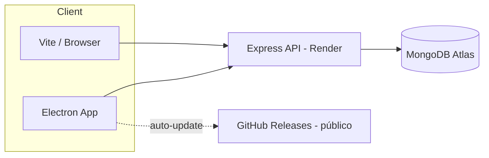
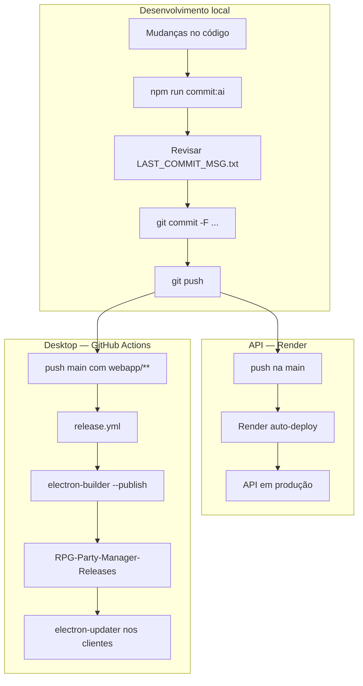

# RPG Party Manager — Visão Geral do Projeto

Documento consolidado sobre o que é o projeto, o que foi implementado até agora, como está organizado e como publicar/atualizar para os usuários.

> **Última atualização:** 2026-07-02  
> **Repositório de código (privado):** [GuilhermeDanzer/RPG-Party-Manager](https://github.com/GuilhermeDanzer/RPG-Party-Manager)  
> **Repositório de releases (público):** [GuilhermeDanzer/RPG-Party-Manager-Releases](https://github.com/GuilhermeDanzer/RPG-Party-Manager-Releases)

---

## 1. O que é

**RPG Party Manager** é uma ferramenta de Mesa (DM) para campanhas D&D 5e com regras homebrew. Substitui a planilha legada *Party Manager 2.7.xlsm* por um app web/desktop moderno.

### Público-alvo

- **DM** que roda a mesa e controla party, combate, bestiário, inventário e notas de campanha.
- **Jogadores** não usam o app diretamente — o DM opera tudo na interface.

### Principais capacidades

| Área | Funcionalidades |
|------|-----------------|
| **Party & Combate** | HP, mana, temp HP, condições (CC), buffs, limit break, battle mode, inimigos, resolução de ataques, targeting em massa, VTT (Owlbear Rodeo) |
| **Homebrew** | Fórmula custom de mana, trait vampiro/blood magic, nível derivado de XP (D&D 5e) |
| **Subclasses** | Subclasses data-driven com resistências, traços passivos e ataques estruturados |
| **Inventário** | Bags por jogador, ouro, paper-doll de equipamento com modificadores |
| **Bestiário** | 800+ monstros em `default_monsters.json` + biblioteca custom, editor de ataques, buff database |
| **Campanha** | Notebook (quests/notas), training tracker, chaos tables |
| **Conta & persistência** | Login JWT, múltiplas campanhas por usuário, auto-save MongoDB, import/export JSON |
| **Desktop** | App Electron com auto-update e instalador Windows |

---

## 2. Stack tecnológica (estado atual)

| Camada | Tecnologia |
|--------|------------|
| Frontend | React 19, TypeScript, Vite 7 |
| Backend | Node.js, Express, Mongoose |
| Banco | MongoDB (Atlas em produção, local opcional) |
| Auth | JWT (Bearer token) |
| Desktop | Electron 41 + electron-builder + electron-updater |
| CI/CD | GitHub Actions (release Windows) |
| API cloud | Render (`rpg-party-manager-api`) |

### Evolução importante

O projeto **não é mais só localStorage**. Hoje:

1. **API hospedada** em `https://rpg-party-manager-api.onrender.com`
2. **Frontend** pode rodar só com Vite (sem Mongo local) apontando para a API na nuvem
3. **Electron empacotado** também usa a API na nuvem (não depende de `localhost:3001` no instalador)
4. **TypeScript** em todo o `webapp/src/` com tipos por domínio em `webapp/src/types/`

---

## 3. Arquitetura

```
RPG-Party-Manager/                    ← código-fonte (repo privado)
├── api/                              Express + Mongoose
│   ├── routes/                       auth, campaigns
│   ├── models/                       User, Campaign, CampaignData
│   └── config/                       defaults, env
├── webapp/                           React SPA + Electron
│   └── src/
│       ├── core/                     App.tsx, GameApp.tsx
│       ├── features/
│       │   ├── auth/                 login/registro
│       │   ├── battle/               party, combate, VTT
│       │   ├── inventory/            bags + paper-doll
│       │   ├── bestiary/             EnemyLibrary, EncounterBuilder
│       │   └── campaign/             Notebook, Training, Chaos, Subclasses, CampaignList
│       ├── shared/utils/             combatUtils, migrationUtils
│       ├── types/                    interfaces por domínio
│       ├── data/                     defaultData, attackSchema
│       └── services/                 cliente HTTP (api.ts)
├── shared/                           cloudDefaults.js (API URL padrão)
├── docs/                             changelogs, templates, este arquivo
└── .github/workflows/                release.yml (build Electron)

RPG-Party-Manager-Releases/           ← repo público (só instaladores)
└── releases/                         .exe, latest.yml, blockmap
```

### Fluxo de dados



### Estado global (`IAppData`)

Campos persistidos por campanha no MongoDB:

- `players`, `equipment`, `library`, `encounters`
- `training`, `chaos`, `notebook`
- `bestiaryReview`, `buffsDatabase`, `subclasses`

Fonte canônica de tipos: `webapp/src/types/index.ts`

---

## 4. Features implementadas (detalhado)

### 4.1 Autenticação e campanhas

- Registro e login com JWT
- Lista de campanhas por usuário
- Criar campanha (com dados default)
- Renomear campanha (`PATCH /campaigns/:id`)
- **Deletar campanha** (`DELETE /campaigns/:id`) — remove campanha + `CampaignData`
- Auto-save com debounce (~800 ms) ao editar dados no `GameApp`
- Import de JSON legado na tela de campanhas
- Export/import manual de save JSON no `GameApp`

### 4.2 Battle / Party Manager

Refatorado de um componente monolítico (~4800 linhas) para:

```
features/battle/
├── PlayerManagerRoot.tsx
├── PlayerManagerView.tsx
├── hooks/
│   ├── usePartyState.ts
│   └── useCombatState.ts
└── components/
    ├── PlayerCard, EnemyCard
    ├── CombatHeader, VttOverlay
    ├── AttackResolutionModal, PartyXpModal
    ├── PartyLevelModal          ← novo
    └── FloatingActionBar
```

**Combate:**

- Battle mode com painel de inimigos
- Resolução de ataques (manual/auto roll)
- Bulk targeting e ações em massa
- VTT overlay (Owlbear Rodeo) no Electron
- `battleNotes` para log de turnos/buffs

**Party:**

- HP, mana, temp HP, limit break
- Buffs com tipos toggle/fixed/turn
- CC (condições) com dropdown padronizado
- XP e nível derivado de thresholds D&D 5e
- **Set Party Level** via modal (aplica nível 1–20 a todos `inParty`)
- Short rest / long rest
- Distribuição de XP da party (modal)

### 4.3 Subclasses customizadas

- Modelo `ISubclass` com resistências, traços passivos, ataques estruturados
- `SubclassManager` — aba dedicada na navegação
- `subclassId` em `IPlayer` equipa subclasse
- `combatUtils` mescla modificadores de dano da subclasse
- Trait `vampire` / blood magic integrado ao pool de HP+mana

### 4.4 Bestiário

- `default_monsters.json` — 800+ monstros com ataques parseados
- `EnemyLibrary` — CRUD de monstros custom, editor de ataques, buffs
- Preview stat-block com rollers
- CC padronizado + opção custom
- `EncounterBuilder` — montar encontros com HP rolado
- `bestiaryReview` — status de revisão por monstro

### 4.5 Inventário

- `Equipment` — bags, ouro, itens maravilhosos
- `CharacterEquipment` — paper-doll (head, armor, weapons, rings, etc.)
- Modificadores de stats, AC, resistências por slot

### 4.6 Ferramentas de campanha

- **Notebook** — páginas quest/nota
- **Training** — progressão por stat com auto-roll
- **Chaos** — tabelas default (Magic Fumble, Wild Magic, Weather) + custom

### 4.7 Normalização e migração

- `migrationUtils.ts` — hidrata saves legados (Excel/export antigo)
- `mergeCampaignData()` — merge com defaults + catálogo
- `toApiPayload()` — serialização para API

### 4.8 Tipagem TypeScript (rigor app-wide)

Módulos de tipos criados:

| Arquivo | Conteúdo |
|---------|----------|
| `types/index.ts` | `IPlayer`, `IEnemy`, `IAppData`, `IMonster`, … |
| `types/battle.ts` | `IPartyState`, `ICombatState`, props de componentes de combate |
| `types/api.ts` | DTOs da API (`IAuthResponse`, `ICampaignDataDto`, …) |
| `types/campaign.ts` | Notebook, Training, Chaos, CampaignList props |
| `types/bestiary.ts` | EnemyLibrary, EncounterBuilder |
| `types/inventory.ts` | Equipment props |
| `types/auth.ts` | AuthScreen, sessão |
| `types/app.ts` | GameApp, `AppTab`, `UpdateAppDataFn` |

`services/api.ts` totalmente tipado (sem `@ts-nocheck`).

---

## 5. API (backend)

### Endpoints principais

| Método | Rota | Descrição |
|--------|------|-----------|
| `POST` | `/auth/register` | Criar conta |
| `POST` | `/auth/login` | Login → JWT |
| `GET` | `/auth/me` | Perfil do usuário logado |
| `GET` | `/health` | Health check (Render) |
| `GET` | `/campaigns` | Listar campanhas do usuário |
| `POST` | `/campaigns` | Criar campanha + dados default |
| `PATCH` | `/campaigns/:id` | Renomear / editar metadados |
| `DELETE` | `/campaigns/:id` | Deletar campanha e dados |
| `GET` | `/campaigns/:id/data` | Carregar estado do jogo |
| `PUT` | `/campaigns/:id/data` | Salvar estado do jogo |

### Deploy (Render)

- Serviço: `rpg-party-manager-api`
- URL: `https://rpg-party-manager-api.onrender.com`
- Config: `render.yaml`
- Env vars: `MONGO_URI`, `JWT_SECRET`, `NODE_ENV`, `CORS_ORIGIN`
- Auto-deploy na `main` do fork conectado

### Defaults cloud

`shared/cloudDefaults.js` define `API_URL` padrão para o frontend/Electron quando não há override local.

---

## 6. Desktop (Electron)

### Comportamento

- **Dev:** `npm run dev` — API local + Electron + Vite
- **Produção:** instalador NSIS Windows com atalho na área de trabalho e menu iniciar
- **Auto-update:** `electron-updater` verifica GitHub Releases no startup
- **API:** build empacotado aponta para Render (não localhost)

### Publicação e distribuição

| Repo | Visibilidade | Conteúdo |
|------|--------------|----------|
| `RPG-Party-Manager` | **Privado** | Código-fonte completo |
| `RPG-Party-Manager-Releases` | **Público** | Só instaladores + `latest.yml` |

**Link fixo para jogadores:**

```
https://github.com/GuilhermeDanzer/RPG-Party-Manager-Releases/releases/latest/download/PartyManager-Setup.exe
```

**Página de releases:**

```
https://github.com/GuilhermeDanzer/RPG-Party-Manager-Releases/releases
```

### CI (GitHub Actions)

Workflow: `.github/workflows/release.yml`

- **Trigger:** push na `main` com mudanças em `webapp/**` (ou tag `v*`)
- **Versão:** `1.0.<build_number>` (ou semver da tag)
- **Publica:** `PartyManager-Setup-<version>.exe`, `PartyManager-Setup.exe`, `latest.yml`
- **Secret:** `RELEASES_REPO_TOKEN` (PAT com acesso ao repo de releases)

### Sobre "Source code" na página de release

O GitHub **adiciona automaticamente** `Source code (zip)` e `Source code (tar.gz)` em toda release com tag. Isso **não é o CI enviando seu código**.

No repo público de releases, esse zip contém **apenas o README** daquele repo (~785 bytes), não o código do app.

> Releases antigas no repo **privado** (ex.: v1.0.3) podem ter zip com o código — considere deletá-las se não forem mais necessárias.

---

## 7. Automação (deploy, commits e PRs)

O projeto tem **três pipelines** distintos: API na nuvem (Render), desktop (GitHub Actions + electron-builder) e mensagens de commit/PR (script local). Nenhum deles faz commit sozinho — você revisa antes de publicar.

### Visão geral



---

### 7.1 Deploy da API (Render) — automático

| Item | Detalhe |
|------|---------|
| **O quê** | Backend Express em `api/` |
| **Como** | Render conectado ao repo privado; blueprint em `render.yaml` |
| **Trigger** | Push na branch `main` (auto-deploy ligado) |
| **Build** | `cd api && npm install` |
| **Start** | `cd api && node server.js` |
| **Health** | `GET /health` |
| **URL** | `https://rpg-party-manager-api.onrender.com` |

**Não há script npm para deploy da API** — basta fazer merge/push na `main`. O frontend e o Electron já apontam para essa URL via `shared/cloudDefaults.js` quando não há `.env` local.

**Env vars no Render:** `MONGO_URI`, `JWT_SECRET`, `NODE_ENV`, `CORS_ORIGIN` (ver `render.yaml`).

---

### 7.2 Deploy do desktop (Electron) — GitHub Actions

| Item | Detalhe |
|------|---------|
| **Workflow** | `.github/workflows/release.yml` |
| **Trigger** | Push na `main` alterando `webapp/**`, `api/**`, `package.json` ou o próprio workflow; também tags `v*` e `workflow_dispatch` manual |
| **Runner** | `windows-latest` |
| **Versão** | `1.0.<GITHUB_RUN_NUMBER>` na main; semver da tag em `v1.2.0` |
| **Destino** | Repo **público** `GuilhermeDanzer/RPG-Party-Manager-Releases` |
| **Secret** | `RELEASES_REPO_TOKEN` (PAT com escopo `repo` no repo de releases) |

**Passos do CI:**

1. Checkout + Node 22
2. Define versão em `webapp/package.json`
3. `npm install` em `api` e `webapp` (sem loop de `postinstall` — ver fix em `package.json` raiz)
4. `npm run build --prefix webapp`
5. `electron-builder --win --publish always` com `GH_TOKEN=RELEASES_REPO_TOKEN`
6. Copia instalador versionado → `PartyManager-Setup.exe` e faz upload com `gh release upload`
7. Artefatos de backup no GitHub Actions

**Scripts npm (raiz e webapp):**

| Comando | Uso |
|---------|-----|
| `npm run build:electron` | Instalador local, **sem** upload |
| `npm run publish:electron` | Build + upload manual (precisa `GH_TOKEN` na máquina) |

**Auto-update:** o app Electron (`webapp/electron/main.cjs`) usa `electron-updater` e lê `latest.yml` do repo público de releases no startup.

---

### 7.3 Commits e PRs — script `commit:ai`

Automação **assistida** (não executa `git commit` nem `gh pr create` sozinha).

| Arquivo | Função |
|---------|--------|
| `scripts/generate-commit.mjs` | Lê o git diff, preenche `docs/PR_TEMPLATE.md`, grava `docs/LAST_COMMIT_MSG.txt` |
| `scripts/commit-ai.sh` | Wrapper bash que chama `npm run commit:ai` e mostra próximos passos |
| `docs/PR_TEMPLATE.md` | Template com **Patch Notes** (DMs) + **Technical Details** |
| `docs/LAST_COMMIT_MSG.txt` | Saída gerada — revisar antes de commitar |
| `.cursorrules` | Regras para humanos e agentes Cursor usarem o mesmo fluxo |

**Comando:**

```bash
npm run commit:ai
```

**O que o script analisa (em ordem de prioridade):**

1. Diff **staged** (`git diff --cached`), se existir
2. Diff **unstaged** + arquivos untracked
3. Diff da branch vs `main` (`git diff main...HEAD`) — útil quando o working tree está limpo mas a branch já tem commits

**Flags opcionais:**

```bash
node scripts/generate-commit.mjs --local    # só mudanças locais, ignora branch
node scripts/generate-commit.mjs --branch   # só diff vs main
```

**Modo LLM (opcional):** com `OPENAI_API_KEY` definida, o script chama a API OpenAI (`gpt-4o-mini` por padrão) para redigir patch notes e detalhes técnicos. Sem a chave, usa **heurísticas** no diff (áreas afetadas, arquivos, tipo de mudança).

**Fluxo recomendado:**

```bash
# 1. Fazer alterações e (opcional) git add
npm run commit:ai

# 2. Revisar e editar se necessário
#    docs/LAST_COMMIT_MSG.txt

# 3. Commit com o texto gerado
git commit -F docs/LAST_COMMIT_MSG.txt

# 4. Push e PR (manual ou via gh)
git push -u origin sua-branch
gh pr create --title "resumo curto" --body-file docs/LAST_COMMIT_MSG.txt
```

**O que o template gera:**

- **Summary** — uma linha do que o PR entrega
- **Patch Notes** — bullets em linguagem de mesa (português)
- **How to test** — checklist para o DM
- **Technical Details** — área, arquitetura, arquivos, verificação (`tsc`, build, etc.)
- **Data model impact** — checkboxes de schema MongoDB / `IAppData`

**Agentes Cursor:** as regras em `.cursorrules` pedem que commits e PRs sigam esse template; o agente pode rodar `commit:ai` ou preencher o mesmo formato manualmente a partir do diff.

---

### 7.4 O que **não** está automatizado

| Ação | Situação |
|------|----------|
| `git commit` / `git push` | Manual (ou pedido explícito ao agente) |
| `gh pr create` | Manual; corpo vem de `LAST_COMMIT_MSG.txt` |
| Deploy frontend estático | Não há — o app é Electron ou Vite local |
| Testes em CI | Não há workflow de test/lint no GitHub Actions hoje |
| `docs/CHANGELOG_AI.md` | Entrada manual após sessões significativas (regra em `.cursorrules`) |

---

## 8. Cronologia de implementações

### Fase inicial — Bestiário e combate

- Migração do Excel/VBA para web
- Bestiário estruturado (808 monstros)
- Parser de ataques (`combatUtils`)
- Fixes de dano duplicado, versatile attacks, Yugoloths
- Notebook, stat-blocks com rollers, auto-CC, temp HP D&D

### Fase estrutural — Refatoração e API

- God component `PlayerManager` → hooks + componentes
- API Express + MongoDB
- Auth JWT + multi-campanha
- Import JSON legado
- Subclasses customizadas
- Normalização de dados (`migrationUtils`)
- Edição direta de nível (XP sync)

### Fase TypeScript e cloud

- Layout feature-driven (`features/battle`, `campaign`, etc.)
- Migração TypeScript com tipos por domínio
- API cloud-ready (CORS, `/health`, Render deploy)
- Cloud defaults (frontend funciona sem Mongo local)
- Tipagem rigorosa em props, DTOs e `services/api.ts`

### Fase UX e campanhas (jul/2026)

- Modal **Set Party Level** (substituiu `window.prompt`)
- **DELETE campanha** na lista
- Deploy Render na `main`

### Fase distribuição desktop (jul/2026)

- `electron-updater` integrado
- CI release no push da `main`
- Fix loop infinito de `postinstall` no GitHub Actions
- Repo público de releases separado
- Dois instaladores: versionado + nome fixo (`PartyManager-Setup.exe`)
- Scripts `publish:electron` / `build:electron` no `webapp/package.json`

### Commits recentes (referência)

```
271448f Publish desktop releases to public releases repository
9cd7fc2 Fix release CI install loop and publish installers
d46ee06 Add fixed installer download alias and publish script
d9980e1 Publish Electron updates on every main push to webapp
cc2b527 Add campaign delete, party level modal, and centralized TypeScript types
```

---

## 9. Comandos úteis

### Desenvolvimento

```bash
npm install                          # instala api + webapp (postinstall)
npm run dev:web                      # API local + Vite
npm run dev                          # API local + Electron
npm run dev --prefix webapp          # só Vite (API na nuvem)
```

### Build

```bash
npm run build --prefix webapp        # build frontend
npm run build:electron               # instalador local (sem upload)
cd webapp && npm run publish:electron  # build + upload manual (precisa GH_TOKEN)
```

### API local

```bash
cp api/.env.example api/.env         # opcional — override dos defaults
npm run dev --prefix api
npm run seed --prefix api
```

### Commits e PRs (ver seção 7.3)

```bash
npm run commit:ai                    # gera docs/LAST_COMMIT_MSG.txt
git commit -F docs/LAST_COMMIT_MSG.txt
gh pr create --body-file docs/LAST_COMMIT_MSG.txt
```

---

## 10. Regras de negócio importantes (não quebrar)

1. **Nível** é derivado de `xp` via thresholds D&D 5e — edições manuais de nível ajustam `xp` para o mínimo do nível.
2. **Não persistir valores derivados** (level, max HP) no Mongo quando podem ser calculados.
3. **Fórmulas de combate** vivem em `shared/utils/combatUtils.ts` — mudanças exigem revisar todos os callers em `features/battle/`.
4. **Subclasses** sobrescrevem traits do jogador via `subclassId`.
5. **Vampire / Blood Magic:** mana merge no pool de HP (`resourceTrait: 'vampire'`).

---

## 11. Documentação relacionada

| Arquivo | Conteúdo |
|---------|----------|
| `README.md` | Setup rápido e comandos |
| `architecture.md` | Design técnico (parcialmente legado — ainda menciona só localStorage em trechos) |
| `docs/mudancas-recentes.md` | Changelog user-facing em português |
| `docs/CHANGELOG_AI.md` | Log de sessões de agentes IA |
| `docs/PR_TEMPLATE.md` | Template de pull request |
| `.cursorrules` | Regras de colaboração para humanos e IA |

---

## 12. Pendências / próximos passos sugeridos

- [ ] Deletar releases antigas no repo privado (v1.0.3) se não forem mais usadas
- [ ] Atualizar `architecture.md` para refletir MongoDB + TypeScript (ainda desatualizado em partes)
- [ ] Habilitar `strict: true` no TypeScript (tipagem interna de hooks legados)
- [ ] Remover `@ts-nocheck` restante em `combatUtils.ts` (parsers OCR internos)
- [ ] Renovar `RELEASES_REPO_TOKEN` quando o PAT expirar
- [ ] Usuários com instalador antigo (repo privado) precisam reinstalar uma vez pelo link público

---

## 13. Links rápidos

| Recurso | URL |
|---------|-----|
| API produção | https://rpg-party-manager-api.onrender.com/health |
| Download app (último) | https://github.com/GuilhermeDanzer/RPG-Party-Manager-Releases/releases/latest/download/PartyManager-Setup.exe |
| Releases | https://github.com/GuilhermeDanzer/RPG-Party-Manager-Releases/releases |
| Código (privado) | https://github.com/GuilhermeDanzer/RPG-Party-Manager |

---

*Documento gerado para consolidar o estado do projeto após as sessões de desenvolvimento com Cursor (jul/2026). Atualize este arquivo quando houver mudanças arquiteturais significativas.*
