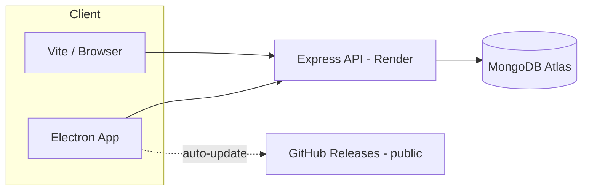
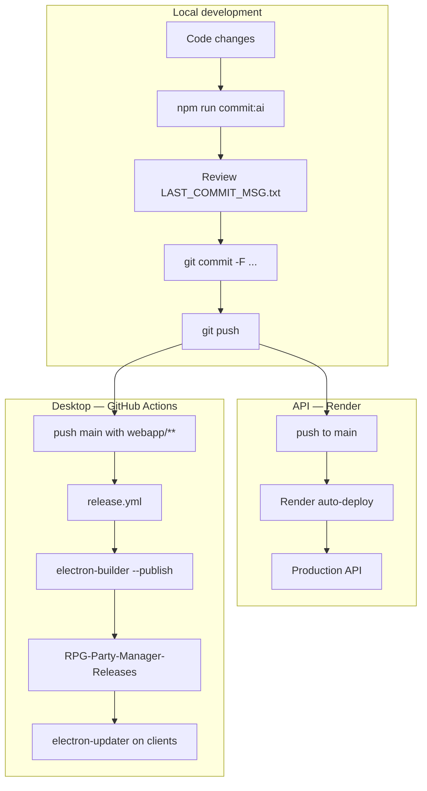

# RPG Party Manager — Project Overview

Consolidated document about what the project is, what has been implemented so far, how it's organized, and how to publish/update for users.

> **Last updated:** 2026-07-02  
> **Source code repo (private):** [GuilhermeDanzer/RPG-Party-Manager](https://github.com/GuilhermeDanzer/RPG-Party-Manager)  
> **Releases repo (public):** [GuilhermeDanzer/RPG-Party-Manager-Releases](https://github.com/GuilhermeDanzer/RPG-Party-Manager-Releases)

---

## 1. What it is

**RPG Party Manager** is a DM (Dungeon Master) tool for D&D 5e campaigns with homebrew rules. It replaces the legacy _Party Manager 2.7.xlsm_ spreadsheet with a modern web/desktop app.

### Target audience

- **DM** who runs the table and controls the party, combat, bestiary, inventory, and campaign notes.
- **Players** do not use the app directly — the DM operates everything through the interface.

### Key capabilities

| Area                      | Features                                                                                                                             |
| ------------------------- | ------------------------------------------------------------------------------------------------------------------------------------ |
| **Party & Combat**        | HP, mana, temp HP, conditions (CC), buffs, limit break, battle mode, enemies, attack resolution, bulk targeting, VTT (Owlbear Rodeo) |
| **Homebrew**              | Custom mana formula, vampire/blood magic trait, level derived from XP (D&D 5e)                                                       |
| **Subclasses**            | Data-driven subclasses with resistances, passive traits, and structured attacks                                                      |
| **Inventory**             | Bags per player, gold, equipment paper-doll with modifiers                                                                           |
| **Bestiary**              | 800+ monsters in `default_monsters.json` + custom library, attack editor, buff database                                              |
| **Campaign**              | Notebook (quests/notes), training tracker, chaos tables                                                                              |
| **Account & persistence** | JWT login, multiple campaigns per user, MongoDB auto-save, JSON import/export                                                        |
| **Desktop**               | Electron app with auto-update and Windows installer                                                                                  |

---

## 2. Tech stack (current state)

| Layer     | Technology                                        |
| --------- | ------------------------------------------------- |
| Frontend  | React 19, TypeScript, Vite 7                      |
| Backend   | Node.js, Express, Mongoose                        |
| Database  | MongoDB (Atlas in production, local optional)     |
| Auth      | JWT (Bearer token)                                |
| Desktop   | Electron 41 + electron-builder + electron-updater |
| CI/CD     | GitHub Actions (Windows release)                  |
| Cloud API | Render (`rpg-party-manager-api`)                  |

### Important evolution

The project **is no longer just localStorage**. Currently:

1. **Hosted API** at `https://rpg-party-manager-api.onrender.com`
2. **Frontend** can run with just Vite (no local Mongo) pointing to the cloud API
3. **Packaged Electron** also uses the cloud API (does not depend on `localhost:3001` in the installer)
4. **TypeScript** across all `webapp/src/` with domain-specific types in `webapp/src/types/`

---

## 3. Architecture

```
RPG-Party-Manager/                    ← source code (private repo)
├── api/                              Express + Mongoose
│   ├── routes/                       auth, campaigns
│   ├── models/                       User, Campaign, CampaignData
│   └── config/                       defaults, env
├── webapp/                           React SPA + Electron
│   └── src/
│       ├── core/                     App.tsx, GameApp.tsx
│       ├── features/
│       │   ├── auth/                 login/register
│       │   ├── battle/               party, combat, VTT
│       │   ├── inventory/            bags + paper-doll
│       │   ├── bestiary/             EnemyLibrary, EncounterBuilder
│       │   └── campaign/             Notebook, Training, Chaos, Subclasses, CampaignList
│       ├── shared/utils/             combatUtils, migrationUtils
│       ├── types/                    domain-specific interfaces
│       ├── data/                     defaultData, attackSchema
│       └── services/                 HTTP client (api.ts)
├── shared/                           cloudDefaults.js (default API URL)
├── docs/                             changelogs, templates, this file
└── .github/workflows/                release.yml (Electron build)

RPG-Party-Manager-Releases/           ← public repo (installers only)
└── releases/                         .exe, latest.yml, blockmap
```

### Data flow



### Global state (`IAppData`)

Fields persisted per campaign in MongoDB:

- `players`, `equipment`, `library`, `encounters`
- `training`, `chaos`, `notebook`
- `bestiaryReview`, `buffsDatabase`, `subclasses`

Canonical type source: `webapp/src/types/index.ts`

---

## 4. Implemented features (detailed)

### 4.1 Authentication and campaigns

- Registration and login with JWT
- Campaign list per user
- Create campaign (with default data)
- Rename campaign (`PATCH /campaigns/:id`)
- **Delete campaign** (`DELETE /campaigns/:id`) — removes campaign + `CampaignData`
- Auto-save with debounce (~800 ms) when editing data in `GameApp`
- Legacy JSON import on the campaigns screen
- Manual save JSON export/import in `GameApp`

### 4.2 Battle / Party Manager

Refactored from a monolithic component (~4800 lines) to:

```
features/battle/
├── PlayerManagerRoot.tsx
├── PlayerManagerView.tsx
├── hooks/
│   ├── usePartyState.ts
│   └── useCombatState.ts
└── components/
    ├── PlayerCard, EnemyCard
    ├── CombatHeader, VttOverlay
    ├── AttackResolutionModal, PartyXpModal
    ├── PartyLevelModal          ← new
    └── FloatingActionBar
```

**Combat:**

- Battle mode with enemy panel
- Attack resolution (manual/auto roll)
- Bulk targeting and mass actions
- VTT overlay (Owlbear Rodeo) in Electron
- `battleNotes` for turn/buff logging

**Party:**

- HP, mana, temp HP, limit break
- Buffs with toggle/fixed/turn types
- CC (conditions) with standardized dropdown
- XP and level derived from D&D 5e thresholds
- **Set Party Level** via modal (applies level 1–20 to all `inParty`)
- Short rest / long rest
- Party XP distribution (modal)

### 4.3 Custom subclasses

- `ISubclass` model with resistances, passive traits, structured attacks
- `SubclassManager` — dedicated navigation tab
- `subclassId` on `IPlayer` equips subclass
- `combatUtils` merges subclass damage modifiers
- `vampire` trait / blood magic integrated into HP+mana pool

### 4.4 Bestiary

- `default_monsters.json` — 800+ monsters with parsed attacks
- `EnemyLibrary` — custom monster CRUD, attack editor, buffs
- Stat-block preview with rollers
- Standardized CC + custom option
- `EncounterBuilder` — build encounters with rolled HP
- `bestiaryReview` — review status per monster

### 4.5 Inventory

- `Equipment` — bags, gold, wondrous items
- `CharacterEquipment` — paper-doll (head, armor, weapons, rings, etc.)
- Stat, AC, and resistance modifiers per slot

### 4.6 Campaign tools

- **Notebook** — quest/note pages
- **Training** — per-stat progression with auto-roll
- **Chaos** — default tables (Magic Fumble, Wild Magic, Weather) + custom

### 4.7 Normalization and migration

- `migrationUtils.ts` — hydrates legacy saves (Excel/old export)
- `mergeCampaignData()` — merge with defaults + catalog
- `toApiPayload()` — serialization for API

### 4.8 TypeScript typing (app-wide rigor)

Type modules created:

| File                 | Content                                               |
| -------------------- | ----------------------------------------------------- |
| `types/index.ts`     | `IPlayer`, `IEnemy`, `IAppData`, `IMonster`, …        |
| `types/battle.ts`    | `IPartyState`, `ICombatState`, combat component props |
| `types/api.ts`       | API DTOs (`IAuthResponse`, `ICampaignDataDto`, …)     |
| `types/campaign.ts`  | Notebook, Training, Chaos, CampaignList props         |
| `types/bestiary.ts`  | EnemyLibrary, EncounterBuilder                        |
| `types/inventory.ts` | Equipment props                                       |
| `types/auth.ts`      | AuthScreen, session                                   |
| `types/app.ts`       | GameApp, `AppTab`, `UpdateAppDataFn`                  |

Fully typed `services/api.ts` (no `@ts-nocheck`).

---

## 5. API (backend)

### Main endpoints

| Method   | Route                 | Description                    |
| -------- | --------------------- | ------------------------------ |
| `POST`   | `/auth/register`      | Create account                 |
| `POST`   | `/auth/login`         | Login → JWT                    |
| `GET`    | `/auth/me`            | Logged-in user profile         |
| `GET`    | `/health`             | Health check (Render)          |
| `GET`    | `/campaigns`          | List user campaigns            |
| `POST`   | `/campaigns`          | Create campaign + default data |
| `PATCH`  | `/campaigns/:id`      | Rename / edit metadata         |
| `DELETE` | `/campaigns/:id`      | Delete campaign and data       |
| `GET`    | `/campaigns/:id/data` | Load game state                |
| `PUT`    | `/campaigns/:id/data` | Save game state                |

### Deploy (Render)

- Service: `rpg-party-manager-api`
- URL: `https://rpg-party-manager-api.onrender.com`
- Config: `render.yaml`
- Env vars: `MONGO_URI`, `JWT_SECRET`, `NODE_ENV`, `CORS_ORIGIN`
- Auto-deploy on `main` of connected fork

### Cloud defaults

`shared/cloudDefaults.js` defines the default `API_URL` for frontend/Electron when there's no local override.

---

## 6. Desktop (Electron)

### Behavior

- **Dev:** `npm run dev` — local API + Electron + Vite
- **Production:** NSIS Windows installer with desktop shortcut and start menu
- **Auto-update:** `electron-updater` checks GitHub Releases on startup
- **API:** packaged build points to Render (not localhost)

### Publishing and distribution

| Repo                         | Visibility  | Content                        |
| ---------------------------- | ----------- | ------------------------------ |
| `RPG-Party-Manager`          | **Private** | Full source code               |
| `RPG-Party-Manager-Releases` | **Public**  | Installers only + `latest.yml` |

**Fixed download link for players:**

```
https://github.com/GuilhermeDanzer/RPG-Party-Manager-Releases/releases/latest/download/PartyManager-Setup.exe
```

**Releases page:**

```
https://github.com/GuilhermeDanzer/RPG-Party-Manager-Releases/releases
```

### CI (GitHub Actions)

Workflow: `.github/workflows/release.yml`

- **Trigger:** push to `main` with changes in `webapp/**` (or `v*` tag)
- **Version:** `1.0.<build_number>` (or tag semver)
- **Publishes:** `PartyManager-Setup-<version>.exe`, `PartyManager-Setup.exe`, `latest.yml`
- **Secret:** `RELEASES_REPO_TOKEN` (PAT with access to releases repo)

### About "Source code" on the release page

GitHub **automatically adds** `Source code (zip)` and `Source code (tar.gz)` to every tagged release. This is **not CI sending your code**.

In the public releases repo, this zip contains **only the README** of that repo (~785 bytes), not the app code.

> Old releases in the **private** repo (e.g., v1.0.3) may have zips with code — consider deleting them if no longer needed.

---

## 7. Automation (deploy, commits, and PRs)

The project has **three distinct pipelines**: cloud API (Render), desktop (GitHub Actions + electron-builder), and commit/PR messages (local script). None of them commit automatically — you review before publishing.

### Overview



---

### 7.1 API deploy (Render) — automated

| Item        | Detail                                                       |
| ----------- | ------------------------------------------------------------ |
| **What**    | Express backend in `api/`                                    |
| **How**     | Render connected to private repo; blueprint in `render.yaml` |
| **Trigger** | Push to `main` branch (auto-deploy enabled)                  |
| **Build**   | `cd api && npm install`                                      |
| **Start**   | `cd api && node server.js`                                   |
| **Health**  | `GET /health`                                                |
| **URL**     | `https://rpg-party-manager-api.onrender.com`                 |

**There is no npm script for API deploy** — just merge/push to `main`. The frontend and Electron already point to this URL via `shared/cloudDefaults.js` when there's no local `.env`.

**Env vars on Render:** `MONGO_URI`, `JWT_SECRET`, `NODE_ENV`, `CORS_ORIGIN` (see `render.yaml`).

---

### 7.2 Desktop deploy (Electron) — GitHub Actions

| Item            | Detail                                                                                                                               |
| --------------- | ------------------------------------------------------------------------------------------------------------------------------------ |
| **Workflow**    | `.github/workflows/release.yml`                                                                                                      |
| **Trigger**     | Push to `main` changing `webapp/**`, `api/**`, `package.json`, or the workflow itself; also `v*` tags and `workflow_dispatch` manual |
| **Runner**      | `windows-latest`                                                                                                                     |
| **Version**     | `1.0.<GITHUB_RUN_NUMBER>` on main; tag semver on `v1.2.0`                                                                            |
| **Destination** | **Public** repo `GuilhermeDanzer/RPG-Party-Manager-Releases`                                                                         |
| **Secret**      | `RELEASES_REPO_TOKEN` (PAT with `repo` scope on releases repo)                                                                       |

**CI steps:**

1. Checkout + Node 22
2. Set version in `webapp/package.json`
3. `npm install` in `api` and `webapp` (no `postinstall` loop — see fix in root `package.json`)
4. `npm run build --prefix webapp`
5. `electron-builder --win --publish always` with `GH_TOKEN=RELEASES_REPO_TOKEN`
6. Copy versioned installer → `PartyManager-Setup.exe` and upload with `gh release upload`
7. Backup artifacts on GitHub Actions

**npm scripts (root and webapp):**

| Command                    | Use                                                 |
| -------------------------- | --------------------------------------------------- |
| `npm run build:electron`   | Local installer, **without** upload                 |
| `npm run publish:electron` | Build + manual upload (needs `GH_TOKEN` on machine) |

**Auto-update:** the Electron app (`webapp/electron/main.cjs`) uses `electron-updater` and reads `latest.yml` from the public releases repo on startup.

---

### 7.3 Commits and PRs — `commit:ai` script

**Assisted** automation (does not run `git commit` or `gh pr create` on its own).

| File                          | Function                                                                       |
| ----------------------------- | ------------------------------------------------------------------------------ |
| `scripts/generate-commit.mjs` | Reads git diff, fills `docs/PR_TEMPLATE.md`, writes `docs/LAST_COMMIT_MSG.txt` |
| `scripts/commit-ai.sh`        | Bash wrapper that calls `npm run commit:ai` and shows next steps               |
| `docs/PR_TEMPLATE.md`         | Template with **Patch Notes** (DMs) + **Technical Details**                    |
| `docs/LAST_COMMIT_MSG.txt`    | Generated output — review before committing                                    |
| `.cursorrules`                | Rules for humans and Cursor agents to use the same flow                        |

**Command:**

```bash
npm run commit:ai
```

**What the script analyzes (in priority order):**

1. **Staged** diff (`git diff --cached`), if present
2. **Unstaged** + untracked files diff
3. Branch diff vs `main` (`git diff main...HEAD`) — useful when working tree is clean but branch already has commits

**Optional flags:**

```bash
node scripts/generate-commit.mjs --local    # only local changes, ignores branch
node scripts/generate-commit.mjs --branch   # only diff vs main
```

**LLM mode (optional):** with `OPENAI_API_KEY` set, the script calls the OpenAI API (`gpt-4o-mini` by default) to draft patch notes and technical details. Without the key, it uses **heuristics** on the diff (affected areas, files, change type).

**Recommended flow:**

```bash
# 1. Make changes and (optional) git add
npm run commit:ai

# 2. Review and edit if needed
#    docs/LAST_COMMIT_MSG.txt

# 3. Commit with generated text
git commit -F docs/LAST_COMMIT_MSG.txt

# 4. Push and PR (manual or via gh)
git push -u origin your-branch
gh pr create --title "short summary" --body-file docs/LAST_COMMIT_MSG.txt
```

**What the template generates:**

- **Summary** — one-liner of what the PR delivers
- **Patch Notes** — bullets in tabletop language
- **How to test** — checklist for the DM
- **Technical Details** — area, architecture, files, verification (`tsc`, build, etc.)
- **Data model impact** — MongoDB / `IAppData` schema checkboxes

**Cursor agents:** rules in `.cursorrules` require commits and PRs to follow this template; the agent can run `commit:ai` or fill in the same format manually from the diff.

---

### 7.4 What is **not** automated

| Action                    | Status                                                           |
| ------------------------- | ---------------------------------------------------------------- |
| `git commit` / `git push` | Manual (or explicit request to agent)                            |
| `gh pr create`            | Manual; body comes from `LAST_COMMIT_MSG.txt`                    |
| Static frontend deploy    | None — the app is Electron or local Vite                         |
| CI tests                  | No test/lint workflow on GitHub Actions today                    |
| `docs/CHANGELOG_AI.md`    | Manual entry after significant sessions (rule in `.cursorrules`) |

---

## 8. Implementation chronology

### Initial phase — Bestiary and combat

- Excel/VBA to web migration
- Structured bestiary (808 monsters)
- Attack parser (`combatUtils`)
- Duplicate damage fixes, versatile attacks, Yugoloths
- Notebook, stat-blocks with rollers, auto-CC, D&D temp HP

### Structural phase — Refactoring and API

- God component `PlayerManager` → hooks + components
- Express API + MongoDB
- JWT auth + multi-campaign
- Legacy JSON import
- Custom subclasses
- Data normalization (`migrationUtils`)
- Direct level editing (XP sync)

### TypeScript and cloud phase

- Feature-driven layout (`features/battle`, `campaign`, etc.)
- TypeScript migration with domain-specific types
- Cloud-ready API (CORS, `/health`, Render deploy)
- Cloud defaults (frontend works without local Mongo)
- Strict typing on props, DTOs, and `services/api.ts`

### UX and campaigns phase (Jul/2026)

- **Set Party Level** modal (replaced `window.prompt`)
- **DELETE campaign** on the list
- Render deploy on `main`

### Desktop distribution phase (Jul/2026)

- `electron-updater` integrated
- CI release on `main` push
- Infinite `postinstall` loop fix on GitHub Actions
- Separate public releases repo
- Two installers: versioned + fixed name (`PartyManager-Setup.exe`)
- `publish:electron` / `build:electron` scripts in `webapp/package.json`

### Recent commits (reference)

```
271448f Publish desktop releases to public releases repository
9cd7fc2 Fix release CI install loop and publish installers
d46ee06 Add fixed installer download alias and publish script
d9980e1 Publish Electron updates on every main push to webapp
cc2b527 Add campaign delete, party level modal, and centralized TypeScript types
```

---

## 9. Useful commands

### Development

```bash
npm install                          # installs api + webapp (postinstall)
npm run dev:web                      # local API + Vite
npm run dev                          # local API + Electron
npm run dev --prefix webapp          # Vite only (cloud API)
```

### Build

```bash
npm run build --prefix webapp        # build frontend
npm run build:electron               # local installer (no upload)
cd webapp && npm run publish:electron  # build + manual upload (needs GH_TOKEN)
```

### Local API

```bash
cp api/.env.example api/.env         # optional — override defaults
npm run dev --prefix api
npm run seed --prefix api
```

### Commits and PRs (see section 7.3)

```bash
npm run commit:ai                    # generates docs/LAST_COMMIT_MSG.txt
git commit -F docs/LAST_COMMIT_MSG.txt
gh pr create --body-file docs/LAST_COMMIT_MSG.txt
```

---

## 10. Important business rules (do not break)

1. **Level** is derived from `xp` via D&D 5e thresholds — manual level edits adjust `xp` to the minimum for that level.
2. **Do not persist derived values** (level, max HP) in Mongo when they can be computed.
3. **Combat formulas** live in `shared/utils/combatUtils.ts` — changes require reviewing all callers in `features/battle/`.
4. **Subclasses** override player traits via `subclassId`.
5. **Vampire / Blood Magic:** mana merges into HP pool (`resourceTrait: 'vampire'`).

---

## 11. Related documentation

| File                     | Content                                                                           |
| ------------------------ | --------------------------------------------------------------------------------- |
| `README.md`              | Quick setup and commands                                                          |
| `architecture.md`        | Technical design (partially outdated — still mentions only localStorage in parts) |
| `docs/recent-changes.md` | User-facing changelog                                                             |
| `docs/CHANGELOG_AI.md`   | AI agent session log                                                              |
| `docs/PR_TEMPLATE.md`    | Pull request template                                                             |
| `.cursorrules`           | Collaboration rules for humans and AI                                             |

---

## 12. Pending / suggested next steps

- [ ] Delete old releases in the private repo (v1.0.3) if no longer used
- [ ] Update `architecture.md` to reflect MongoDB + TypeScript (still outdated in parts)
- [ ] Enable `strict: true` in TypeScript (internal typing of legacy hooks)
- [ ] Remove remaining `@ts-nocheck` in `combatUtils.ts` (internal OCR parsers)
- [ ] Renew `RELEASES_REPO_TOKEN` when PAT expires
- [ ] Users with old installer (private repo) need to reinstall once from the public link

---

## 13. Quick links

| Resource              | URL                                                                                                           |
| --------------------- | ------------------------------------------------------------------------------------------------------------- |
| Production API        | https://rpg-party-manager-api.onrender.com/health                                                             |
| App download (latest) | https://github.com/GuilhermeDanzer/RPG-Party-Manager-Releases/releases/latest/download/PartyManager-Setup.exe |
| Releases              | https://github.com/GuilhermeDanzer/RPG-Party-Manager-Releases/releases                                        |
| Code (private)        | https://github.com/GuilhermeDanzer/RPG-Party-Manager                                                          |

---

_Document generated to consolidate the project state after development sessions with Cursor (Jul/2026). Update this file when there are significant architectural changes._
