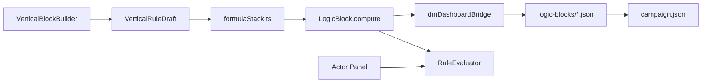

# Relatório — Editor de Regras, Bugs Observados e SRD

**Data:** 2026-07-02  
**Escopo:** DM Test Dashboard · Vertical Block Builder · `RuleEvaluator` · `SRDIntegrationService`  
**Fuso:** BRT

---

## 1. Resumo executivo

O **Editor de Regras** vive no **DM Test Dashboard** (`DmDashboard` → `BlockEditor`). Ele permite montar fórmulas homebrew em passos verticais, compilar para `LogicBlock.compute` e pré-visualizar resultados por ator.

Foram identificados **três problemas de UX/dados** alinhados ao que você descreveu:

| # | Sintoma | Causa raiz (código) | Severidade |
|---|---------|---------------------|------------|
| A | Condição “Tipo de ator” presa em `player`; clicar não ajuda | Valor é `<input>` texto; regra seed `MANA_MAX_RULE` já filtra só `player`; sem dropdown | Alta (UX) |
| B | Wizard: INT fixo ≠ “atributo principal (classe)” / conjuração estranha | `ActorPanel` **não edita `classType`**; `getPrimaryAbilityScore` faz **fallback para STR** sem classe; conjuração retorna `null` e quebra | Alta (lógica) |
| C | Não aparece UI para importar spells/items do D&D | `useSRDSync` e `SRDIntegrationService` existem, mas **nenhum componente React os monta** | Média (feature incompleta) |

---

## 2. Como o editor funciona hoje

### 2.1 Onde acessar

```
Campanhas → botão DM Dashboard → seção "Editor de Regras"
```

Requer **Electron** (`npm run electron:dev`) para persistência real. No browser, blocos vão para `sessionStorage`.

### 2.2 Fluxo de dados



### 2.3 Arquivos principais

| Papel | Caminho |
|-------|---------|
| Shell UI | `webapp/src/components/RulesEditor/BlockEditor.tsx` |
| Builder visual | `webapp/src/components/RulesEditor/VerticalBlockBuilder.tsx` |
| Estado / save | `webapp/src/components/RulesEditor/useRulesEditor.ts` |
| Draft ↔ JSON | `webapp/src/components/RulesEditor/formulaStack.ts` |
| Labels amigáveis | `webapp/src/shared/schema/SchemaResolver.ts` |
| Classe → atributo | `webapp/src/shared/schema/classAbilityMap.ts` |
| Motor | `webapp/src/engine/RuleEvaluator.ts` |
| Atores | `webapp/src/features/dashboard/components/ActorPanel.tsx` |
| Persistência | `webapp/src/electron-main/dashboardIpc.ts` |

### 2.4 Modelo `LogicBlock` (resumo)

- **`compute`** — fórmula numérica (`RuleExpression`: literal, field, binary, formula).
- **`conditions`** — filtros antes de calcular (ex.: `actor.kind === 'player'`).
- **`trigger`** — quando rodaria em runtime (`manual`, `on_spell_cast`, …).
- **`deleted`** — soft delete (tombstone para sync).
- **`customAttributes._verticalRuleDraft`** — rascunho da UI (passos amigáveis).

---

## 3. Bug A — Condição “Tipo de ator” / só `player`

### O que você viu

Na seção **Condições** da regra, o campo parece fixo em `player`. Ao clicar, nada útil acontece.

### O que o código faz

1. **Regra padrão** `MANA_MAX_RULE` (`dashboardDefaults.ts`) já inclui:

   ```json
   { "field": "actor.kind", "op": "eq", "value": "player" }
   ```

   No preview, **Goblin** e outros tipos aparecem como *“N/A (condição não atendida)”* — comportamento esperado dessa condição.

2. **UI de condições** (`VerticalBlockBuilder.tsx`, ~linha 277): o valor é um `<input type="text">` genérico, **não** um `<select>` com `player | npc | monster`.

3. Ao adicionar condição (`addCondition`), o default é sempre:

   ```ts
   friendlyLabel: 'Tipo de ator',
   op: 'eq',
   value: 'player',
   ```

### Por que parece “travado”

- Se a expectativa é um **dropdown de tipo**, a UI atual não oferece isso — só texto livre.
- Se a regra em edição é a **Mana Maximum** herdada do seed, a condição `player` volta ao recarregar (a menos que você a remova e salve).
- Clicar no `<select>` de **campo** (`SchemaSelect`) funciona, mas o **valor** continua sendo caixa de texto — fácil confundir com “não faz nada”.

### Correção recomendada

- Quando `friendlyLabel === 'Tipo de ator'`, renderizar `<select>` com `player`, `npc`, `monster`.
- Documentar na UI que condições filtram o preview por ator.
- Opcional: regra seed sem condição, ou condição editável com valor inicial vazio.

> **Atualização (2026-07-02):** implementado `<select>` para tipo de ator em `VerticalBlockBuilder.tsx` (`ACTOR_KIND_OPTIONS`). O modelo usa `actor.kind`, não `actor.type`.

---

## 4. Bug B — Wizard / INT vs atributos de classe

### O que você viu

Para uma Wizard, **Inteligência (INT)** fixa na fórmula dá um número, mas **“Atributo principal (classe)”** e **“Atributo de conjuração (classe)”** divergem ou caem em valor “errado” (ex.: parece CON ou STR).

### Mapeamento esperado (Wizard)

Em `classAbilityMap.ts`:

```ts
wizard: { spellcasting: 'int', primary: 'int' },
mago:   { spellcasting: 'int', primary: 'int' },
```

Para `classType: 'Wizard'` e `stats.int: 17`, **ambos** os campos virtuais deveriam retornar **17**.

### Causa raiz: classe não está no ator na UI

`getActorClassName()` lê apenas:

```ts
customAttributes.classType ?? customAttributes.class ?? customAttributes.className
```

O **`ActorPanel` não expõe campo de classe**. Só edita:

- `kind` (player / npc / monster)
- stats, HP, mana, level
- visibility, conditions CSV

| Ator sample | `classType` no JSON | Efeito nas regras de classe |
|-------------|---------------------|------------------------------|
| Lyra (seed) | `'Wizard'` | Conjuração e principal → INT (17) ✓ |
| Goblin | *(ausente)* | Ver tabela abaixo |
| New Actor | *(ausente)* | Ver tabela abaixo |

### Comportamento **sem** `classType` (bug de fallback assimétrico)

| Campo na regra | Resolução em `classAbilityMap.ts` | Resultado típico (stats 10) |
|----------------|-----------------------------------|-----------------------------|
| `Inteligência (INT)` fixo | `actor.stats.int` | **17** (valor real do ator) |
| Atributo de **conjuração** (classe) | `spellcasting` → `null` se sem classe | **Erro** no preview (`Field "…" is not numeric`) |
| Atributo **principal** (classe) | `primary ?? 'str'` — **fallback STR** | **10** (STR), não INT |

Isso explica exatamente: **INT fixo = 17**, **principal (classe) = 10 (STR)** quando a classe não está definida no ator.

### Outro detalhe: default da fórmula

O primeiro passo da regra nova usa `DEFAULT_FRIENDLY_LABEL = 'Constituição (CON)'` em `SchemaResolver.ts`. Isso é independente dos campos de classe, mas reforça a sensação de “cair no default errado” se você não trocar o operando inicial.

### Correção recomendada

1. **ActorPanel:** campo `Classe (D&D)` → `customAttributes.classType` com opções (Wizard, Cleric, …) ou texto livre alinhado ao `CLASS_ABILITY_MAP`.
2. **classAbilityMap.ts:** se não houver classe, `getPrimaryAbilityScore` não deveria silenciosamente usar STR — retornar `null` e erro claro (simétrico à conjuração).
3. **Preview / RuleEvaluator:** mensagem amigável: *“Defina classType no ator (ex.: Wizard)”*.
4. **Teste de aceite:** Lyra com `classType: 'Wizard'`, fórmula = só “Atributo de conjuração (classe)” → resultado **17**; igual para “Atributo principal (classe)”.

---

## 5. Lacuna C — UI de sincronização SRD (spells & items)

### O que foi implementado (backend)

| Peça | Status |
|------|--------|
| `SRDIntegrationService.ts` | ✓ Fetch batched em `dnd5eapi.co` |
| Adaptadores `adaptSpellToRulesEngine` / `adaptEquipmentToCatalogItem` | ✓ |
| `SyncService.mergeSrdCatalogBatch()` | ✓ Grava em `IAppData.srdCatalog` |
| IPC `srd:merge-catalog-batch` | ✓ Electron main |
| Hook `useSRDSync` | ✓ `startImport`, progresso, contadores |

### O que **não** foi implementado (UI)

**Nenhum** arquivo em `features/` ou `components/` importa `useSRDSync`.

Busca no repositório:

```
useSRDSync  →  apenas em shared/hooks/useSRDSync.ts
```

`DmDashboard.tsx` tem: Actor Panel, Rule Debug, VTT/Sync Status, Editor de Regras — **sem painel SRD**.

### Como deveria aparecer (proposta)

Nova seção no dashboard ou em Campanhas:

```tsx
// Exemplo — ainda não existe no repo
import { useSRDSync } from '../../shared/hooks/useSRDSync';

function SrdImportPanel() {
  const srd = useSRDSync();
  // Botão "Importar SRD", <progress>, spellCount / equipmentCount
}
```

### Onde os dados vão parar hoje (se chamar o hook manualmente)

- **Electron:** `campaign.json` → `data.srdCatalog.spells[]` e `.equipment[]`
- **Browser dev:** `sessionStorage` chave `rpg-srd-catalog-dev`
- **Não** aparecem na lista “Suas regras” do editor nem no `RuleDebugConsole`

---

## 6. Outras limitações conhecidas

| Item | Detalhe |
|------|---------|
| Editor isolado do combate | Regras do dashboard não entram em `GameApp` / campanha MongoDB ativa |
| `RuleDebugConsole` | Avalia só `MANA_MAX_RULE` hardcoded — ignora regras criadas no editor |
| `effects` no `LogicBlock` | Tipo suporta mutação de ator; UI não edita |
| Legado React Flow | Arquivos em `RulesEditor/nodes/` não usados |
| SRD ↔ Editor | Magias importadas ficam em `srdCatalog`, separadas do painel de regras |

---

## 7. Plano de correção sugerido (prioridade)

### P0 — Bugs que você reportou

1. Campo **Classe** no `ActorPanel` (`customAttributes.classType`).
2. Fallback simétrico em `classAbilityMap` (sem classe → erro explícito, não STR silencioso).
3. Condição **Tipo de ator** com `<select>` em vez de texto livre.
4. Componente **`SrdImportPanel`** no `DmDashboard` usando `useSRDSync`.

### P1 — Consistência

5. `RuleDebugConsole` ler blocos do editor (não só `MANA_MAX_RULE`).
6. Listar spells SRD importadas no editor ou painel dedicado.

### P2 — Produto

7. Ligar `logicBlocks` à campanha ativa (`IAppData` / `GameApp`).
8. Remover arquivos mortos do React Flow.

---

## 8. Como reproduzir os bugs localmente

### Bug B (classe / INT)

1. `npm run electron:dev` → DM Dashboard → Seed sample.
2. Editor de Regras → nova regra → passo 1 = **Atributo principal (classe)**.
3. Preview em **Goblin** (sem `classType`) → valor **8** (STR), não INT.
4. Mesmo teste com **Inteligência (INT)** → **10**.
5. Em **Lyra (Wizard)** com `classType` no JSON → ambos campos de classe devem dar **17**.

### Bug A (condição player)

1. Abrir regra **Mana Maximum**.
2. Ver condição `Tipo de ator = player`.
3. Goblin no preview → skipped; Lyra → calcula.

### Bug C (SRD UI ausente)

1. Abrir DM Dashboard inteiro — não há botão “Importar SRD”.
2. Confirmar: `webapp/src/shared/hooks/useSRDSync.ts` existe; nenhum `.tsx` o importa.

---

## 9. Referência rápida — campos amigáveis de classe

| Label na UI | Path técnico | Resolução |
|-------------|--------------|-----------|
| Atributo de conjuração (classe) | `actor.spellcastingAbility` | Mapa D&D 5e → stat |
| Atributo principal (classe) | `actor.primaryAbility` | Mapa D&D 5e → stat |
| Classe do ator | `actor.customAttributes.classType` | String (condições) |
| Inteligência (INT) | `actor.stats.int` | Valor direto |

**Requisito:** `customAttributes.classType` deve ser `Wizard`, `Mago`, `Cleric`, etc. (chaves em `CLASS_ABILITY_MAP` após `normalizeClassKey`).

---

## 10. Conclusão

O **motor de regras e o editor vertical estão funcionais** para fórmulas com atributos fixos e para atores com `classType` definido no JSON (ex.: Lyra no seed).

Os problemas que você viu vêm principalmente de:

1. **UI incompleta** — sem classe no ator e sem painel SRD.
2. **Fallback assimétrico** — principal → STR, conjuração → null/erro, quando a classe falta.
3. **Condições pouco guiadas** — valor `player` em texto livre e regra seed pré-filtrada.

O próximo passo natural é implementar o **P0** acima; o hook `useSRDSync` já está pronto para plugar a UI de importação.
