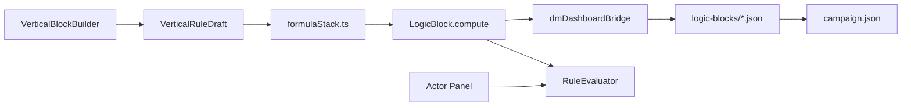

# Report — Rules Editor, Observed Bugs, and SRD

**Date:** 2026-07-02  
**Scope:** DM Test Dashboard · Vertical Block Builder · `RuleEvaluator` · `SRDIntegrationService`  
**Timezone:** BRT

---

## 1. Executive summary

The **Rules Editor** lives in the **DM Test Dashboard** (`DmDashboard` → `BlockEditor`). It allows building homebrew formulas in vertical steps, compiling to `LogicBlock.compute`, and previewing results per actor.

**Three UX/data issues** were identified matching what you described:

| #   | Symptom                                                             | Root cause (code)                                                                                                                             | Severity                    |
| --- | ------------------------------------------------------------------- | --------------------------------------------------------------------------------------------------------------------------------------------- | --------------------------- |
| A   | "Actor type" condition stuck on `player`; clicking doesn't help     | Value is a `<input>` text field; seed rule `MANA_MAX_RULE` already filters only `player`; no dropdown                                         | High (UX)                   |
| B   | Wizard: fixed INT ≠ "primary ability (class)" / casting looks wrong | `ActorPanel` **does not edit `classType`**; `getPrimaryAbilityScore` **falls back to STR** without a class; casting returns `null` and breaks | High (logic)                |
| C   | No UI to import spells/items from D&D                               | `useSRDSync` and `SRDIntegrationService` exist, but **no React component mounts them**                                                        | Medium (incomplete feature) |

---

## 2. How the editor works today

### 2.1 Where to access

```
Campaigns → DM Dashboard button → "Rules Editor" section
```

Requires **Electron** (`npm run electron:dev`) for real persistence. In the browser, blocks go to `sessionStorage`.

### 2.2 Data flow



### 2.3 Key files

| Role              | Path                                                         |
| ----------------- | ------------------------------------------------------------ |
| UI Shell          | `webapp/src/components/RulesEditor/BlockEditor.tsx`          |
| Visual Builder    | `webapp/src/components/RulesEditor/VerticalBlockBuilder.tsx` |
| State / save      | `webapp/src/components/RulesEditor/useRulesEditor.ts`        |
| Draft ↔ JSON      | `webapp/src/components/RulesEditor/formulaStack.ts`          |
| Friendly labels   | `webapp/src/shared/schema/SchemaResolver.ts`                 |
| Class → attribute | `webapp/src/shared/schema/classAbilityMap.ts`                |
| Engine            | `webapp/src/engine/RuleEvaluator.ts`                         |
| Actors            | `webapp/src/features/dashboard/components/ActorPanel.tsx`    |
| Persistence       | `webapp/src/electron-main/dashboardIpc.ts`                   |

### 2.4 `LogicBlock` model (summary)

- **`compute`** — numeric formula (`RuleExpression`: literal, field, binary, formula).
- **`conditions`** — filters before computing (e.g., `actor.kind === 'player'`).
- **`trigger`** — when it would run at runtime (`manual`, `on_spell_cast`, …).
- **`deleted`** — soft delete (tombstone for sync).
- **`customAttributes._verticalRuleDraft`** — UI draft (friendly steps).

---

## 3. Bug A — "Actor type" condition / only `player`

### What you saw

In the rule **Conditions** section, the field appears fixed to `player`. When clicking, nothing useful happens.

### What the code does

1. **Default rule** `MANA_MAX_RULE` (`dashboardDefaults.ts`) already includes:

   ```json
   { "field": "actor.kind", "op": "eq", "value": "player" }
   ```

   In the preview, **Goblin** and other types appear as _"N/A (condition not met)"_ — expected behavior for this condition.

2. **Conditions UI** (`VerticalBlockBuilder.tsx`, ~line 277): the value is a generic `<input type="text">`, **not** a `<select>` with `player | npc | monster`.

3. When adding a condition (`addCondition`), the default is always:

   ```ts
   friendlyLabel: 'Tipo de ator',
   op: 'eq',
   value: 'player',
   ```

### Why it seems "stuck"

- If the expectation is a **type dropdown**, the current UI doesn't offer that — only free text.
- If the rule being edited is **Mana Maximum** inherited from the seed, the `player` condition returns on reload (unless you remove and save it).
- Clicking the **field** `<select>` (`SchemaSelect`) works, but the **value** remains a text box — easy to confuse with "does nothing".

### Recommended fix

- When `friendlyLabel === 'Tipo de ator'`, render `<select>` with `player`, `npc`, `monster`.
- Document in the UI that conditions filter the preview by actor.
- Optional: seed rule without a condition, or condition with an empty initial value.

> **Update (2026-07-02):** implemented `<select>` for actor type in `VerticalBlockBuilder.tsx` (`ACTOR_KIND_OPTIONS`). The model uses `actor.kind`, not `actor.type`.

---

## 4. Bug B — Wizard / INT vs class attributes

### What you saw

For a Wizard, fixed **Intelligence (INT)** in the formula gives a number, but **"Primary ability (class)"** and **"Spellcasting ability (class)"** diverge or fall to a "wrong" value (e.g., appears CON or STR).

### Expected mapping (Wizard)

In `classAbilityMap.ts`:

```ts
wizard: { spellcasting: 'int', primary: 'int' },
mago:   { spellcasting: 'int', primary: 'int' },
```

For `classType: 'Wizard'` and `stats.int: 17`, **both** virtual fields should return **17**.

### Root cause: class is not on the actor in the UI

`getActorClassName()` reads only:

```ts
customAttributes.classType ??
  customAttributes.class ??
  customAttributes.className
```

The **`ActorPanel` does not expose a class field**. It only edits:

- `kind` (player / npc / monster)
- stats, HP, mana, level
- visibility, conditions CSV

| Sample actor | `classType` in JSON | Effect on class rules            |
| ------------ | ------------------- | -------------------------------- |
| Lyra (seed)  | `'Wizard'`          | Casting and primary → INT (17) ✓ |
| Goblin       | _(absent)_          | See table below                  |
| New Actor    | _(absent)_          | See table below                  |

### Behavior **without** `classType` (asymmetric fallback bug)

| Field in rule                    | Resolution in `classAbilityMap.ts`    | Typical result (stats 10)                         |
| -------------------------------- | ------------------------------------- | ------------------------------------------------- |
| `Intelligence (INT)` fixed       | `actor.stats.int`                     | **17** (actor's actual value)                     |
| **Spellcasting** ability (class) | `spellcasting` → `null` if no class   | **Error** in preview (`Field "…" is not numeric`) |
| **Primary** ability (class)      | `primary ?? 'str'` — **fallback STR** | **10** (STR), not INT                             |

This exactly explains: **fixed INT = 17**, **primary (class) = 10 (STR)** when the class is not defined on the actor.

### Another detail: formula default

The first step of a new rule uses `DEFAULT_FRIENDLY_LABEL = 'Constituição (CON)'` in `SchemaResolver.ts`. This is independent of class fields, but reinforces the "falling to wrong default" feeling if you don't change the initial operand.

### Recommended fix

1. **ActorPanel:** field `Class (D&D)` → `customAttributes.classType` with options (Wizard, Cleric, …) or free text aligned to `CLASS_ABILITY_MAP`.
2. **classAbilityMap.ts:** if no class, `getPrimaryAbilityScore` should not silently use STR — return `null` and clear error (symmetric to casting).
3. **Preview / RuleEvaluator:** friendly message: _"Set classType on actor (e.g., Wizard)"_.
4. **Acceptance test:** Lyra with `classType: 'Wizard'`, formula = only "Spellcasting ability (class)" → result **17**; same for "Primary ability (class)".

---

## 5. Gap C — SRD sync UI (spells & items)

### What was implemented (backend)

| Piece                                                              | Status                              |
| ------------------------------------------------------------------ | ----------------------------------- |
| `SRDIntegrationService.ts`                                         | ✓ Batched fetch from `dnd5eapi.co`  |
| Adapters `adaptSpellToRulesEngine` / `adaptEquipmentToCatalogItem` | ✓                                   |
| `SyncService.mergeSrdCatalogBatch()`                               | ✓ Saves to `IAppData.srdCatalog`    |
| IPC `srd:merge-catalog-batch`                                      | ✓ Electron main                     |
| Hook `useSRDSync`                                                  | ✓ `startImport`, progress, counters |

### What was **not** implemented (UI)

**No** file in `features/` or `components/` imports `useSRDSync`.

Repository search:

```
useSRDSync  →  only in shared/hooks/useSRDSync.ts
```

`DmDashboard.tsx` has: Actor Panel, Rule Debug, VTT/Sync Status, Rules Editor — **no SRD panel**.

### How it should appear (proposal)

New section in the dashboard or Campaigns:

```tsx
// Example — does not yet exist in the repo
import { useSRDSync } from '../../shared/hooks/useSRDSync'

function SrdImportPanel() {
  const srd = useSRDSync()
  // "Import SRD" button, <progress>, spellCount / equipmentCount
}
```

### Where data ends up today (if calling the hook manually)

- **Electron:** `campaign.json` → `data.srdCatalog.spells[]` and `.equipment[]`
- **Dev browser:** `sessionStorage` key `rpg-srd-catalog-dev`
- **Does not** appear in the editor's "Your rules" list or `RuleDebugConsole`

---

## 6. Other known limitations

| Item                        | Detail                                                                         |
| --------------------------- | ------------------------------------------------------------------------------ |
| Editor isolated from combat | Dashboard rules don't enter `GameApp` / active campaign MongoDB                |
| `RuleDebugConsole`          | Evaluates only hardcoded `MANA_MAX_RULE` — ignores rules created in the editor |
| `effects` in `LogicBlock`   | Type supports actor mutation; UI doesn't edit                                  |
| Legacy React Flow           | Files in `RulesEditor/nodes/` unused                                           |
| SRD ↔ Editor                | Imported spells stay in `srdCatalog`, separate from rules panel                |

---

## 7. Suggested fix plan (priority)

### P0 — Bugs you reported

1. **Class** field in `ActorPanel` (`customAttributes.classType`).
2. Symmetric fallback in `classAbilityMap` (no class → explicit error, not silent STR).
3. **Actor type** condition with `<select>` instead of free text.
4. **`SrdImportPanel`** component in `DmDashboard` using `useSRDSync`.

### P1 — Consistency

5. `RuleDebugConsole` read editor blocks (not just `MANA_MAX_RULE`).
6. List imported SRD spells in the editor or dedicated panel.

### P2 — Product

7. Connect `logicBlocks` to the active campaign (`IAppData` / `GameApp`).
8. Remove dead React Flow files.

---

## 8. How to reproduce bugs locally

### Bug B (class / INT)

1. `npm run electron:dev` → DM Dashboard → Seed sample.
2. Rules Editor → new rule → step 1 = **Primary ability (class)**.
3. Preview on **Goblin** (without `classType`) → value **8** (STR), not INT.
4. Same test with **Intelligence (INT)** → **10**.
5. On **Lyra (Wizard)** with `classType` in JSON → both class fields should give **17**.

### Bug A (player condition)

1. Open **Mana Maximum** rule.
2. See condition `Actor type = player`.
3. Goblin in preview → skipped; Lyra → computes.

### Bug C (missing SRD UI)

1. Open full DM Dashboard — no "Import SRD" button.
2. Confirm: `webapp/src/shared/hooks/useSRDSync.ts` exists; no `.tsx` imports it.

---

## 9. Quick reference — friendly class fields

| UI Label                     | Technical path                     | Resolution          |
| ---------------------------- | ---------------------------------- | ------------------- |
| Spellcasting ability (class) | `actor.spellcastingAbility`        | D&D 5e map → stat   |
| Primary ability (class)      | `actor.primaryAbility`             | D&D 5e map → stat   |
| Actor class                  | `actor.customAttributes.classType` | String (conditions) |
| Intelligence (INT)           | `actor.stats.int`                  | Direct value        |

**Requirement:** `customAttributes.classType` must be `Wizard`, `Mago`, `Cleric`, etc. (keys in `CLASS_ABILITY_MAP` after `normalizeClassKey`).

---

## 10. Conclusion

The **rules engine and vertical editor are functional** for formulas with fixed attributes and for actors with `classType` defined in JSON (e.g., Lyra in the seed).

The problems you saw come mainly from:

1. **Incomplete UI** — no class on actor and no SRD panel.
2. **Asymmetric fallback** — primary → STR, casting → null/error, when class is missing.
3. **Poorly guided conditions** — `player` value in free text and pre-filtered seed rule.

The natural next step is to implement **P0** above; the `useSRDSync` hook is already ready to plug into the import UI.
