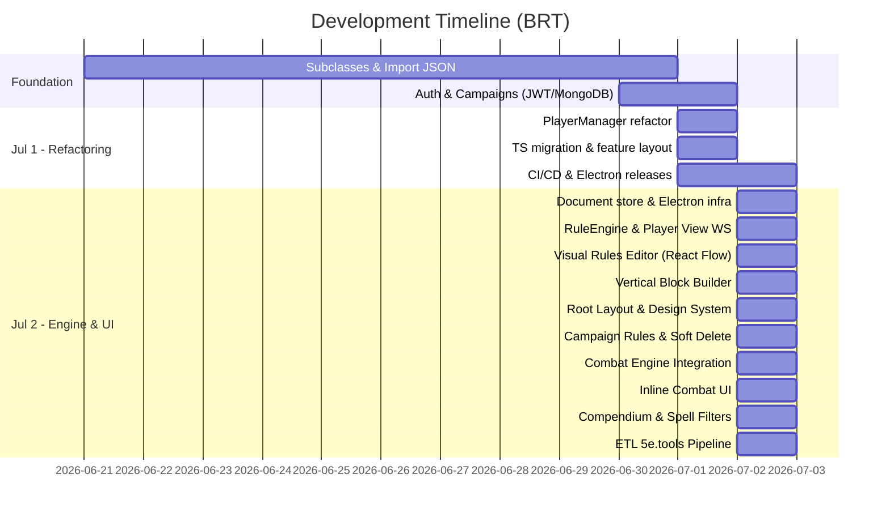
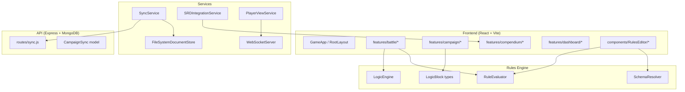

# RPG Party Manager — Project Report

**Generated:** 2026-07-03  
**Sources:** [CHANGELOG_AI.md](file:///d:/Dev/RPG-Party-Manager/docs/CHANGELOG_AI.md) · [mudancas-recentes.md](file:///d:/Dev/RPG-Party-Manager/docs/mudancas-recentes.md)

---

## Executive Summary

Between **June 21** and **July 2, 2026**, the RPG Party Manager underwent an intensive sprint — primarily driven by **Cursor AI** sessions — that transformed the project from a monolithic prototype into a feature-rich, modular D&D 5e campaign management tool. The work spans **20+ documented change sections** across frontend, backend, desktop (Electron), and infrastructure.

---

## Timeline Overview

---

## Key Areas of Work

### 1. 🏗️ Architecture & Refactoring

| Change | Details |
|--------|---------|
| **PlayerManager decomposition** | Monolith (~4,800 lines) split into `features/battle/` with `usePartyState`, `useCombatState`, and dedicated components |
| **Feature-driven layout** | Codebase reorganized into `src/core`, `src/features/*`, `src/shared`, `src/types` |
| **TypeScript migration** | Domain types split by area (`api.ts`, `battle.ts`, `campaign.ts`, `bestiary.ts`, etc.); `services/api.ts` fully typed |
| **Tailwind removal** | All UI migrated to plain CSS with a custom design system (`design-system.css`, `layout.css`, component CSS) |
| **RootLayout** | Global shell component with `max-width: 80rem`, centered margins, responsive grid |

### 2. ⚙️ Rules Engine (Homebrew)

This is the most substantial new system. It was built iteratively across 8+ sessions:

| Layer | Purpose | Key Files |
|-------|---------|-----------|
| **RuleEvaluator** | Numeric formula evaluation (no `eval()`) with operator map | `engine/RuleEvaluator.ts` |
| **LogicEngine** | Mutates actor state via `effects` | `services/homebrew/LogicEngine.ts` |
| **LogicBlock** | JSON-serializable rule definition with `compute`, `effects`, `trigger`, `scope` | `types/domain/logic-block.ts` |
| **Visual Editor v1** | React Flow node-based editor with Variable/Math/Literal blocks | `components/RulesEditor/*` |
| **Vertical Block Builder** | Replaced React Flow with stacked vertical blocks, friendly labels | `components/RulesEditor/VerticalBlockBuilder.tsx` |
| **SchemaResolver** | Maps friendly names (e.g., "Constitution (CON)") to dot-paths (`actor.stats.con`) | `shared/schema/SchemaResolver.ts` |
| **Campaign Rules Panel** | Toggle rules on/off per campaign; import from DM Dashboard | `features/campaign/CampaignRulesPanel.tsx` |
| **Combat Integration** | Rules fire on `on_damage`, `on_heal`, `on_turn_start`, `on_spell_cast` | `campaignRulesRuntime.ts` |

> [!IMPORTANT]
> Rules now **actively affect** mana max, HP max, and combat damage via the pipeline — they are no longer just visual definitions.

### 3. ⚔️ Combat System

| Feature | Description |
|---------|-------------|
| **QuickActionBar** | Inline damage/heal with numeric input, damage type selector, and RuleEngine pipeline |
| **ActorModifierBadges** | Resistance, immunity, vulnerability, and condition badges on each card |
| **EncounterScenePanel** | Lists encounter-scoped rules; "Advance Turn" triggers `on_turn_start` rules |
| **Mana vs Spell Slots toggle** | Campaign rules panel lets DM switch between homebrew mana and D&D 5e spell slots |
| **HP inflation fix** | `actorToPlayer` no longer writes inflated max HP into `hpBase`; auto-repair on load |

### 4. 📚 Compendium & SRD

| Feature | Description |
|---------|-------------|
| **Compendium View** | Spells & Items tabs with search, detail cards, and `getSrdCatalog` via IPC/sessionStorage |
| **Spell Filters** | Level, school, class, casting time, duration, range, ritual, concentration, components (V/S/M), damage, save |
| **SRDIntegrationService** | Fetches from `dnd5eapi.co` with batching; adapters to `LogicBlock`/`IInventoryItem` |
| **ETL 5e.tools** | `FiveEToolsSanitizer`, `SpellAdapter`, seed PHB → MongoDB `compendium_spells` |

### 5. 🔄 Sync & Persistence

| Feature | Description |
|---------|-------------|
| **SyncService** | Offline-first with `campaign.json`, `isDirty` flag, push/pull `/sync`, auto-retry 30s |
| **FileSystemDocumentStore** | One `.json` per document in `{userData}/documents/` |
| **Soft delete** | Logic blocks use tombstones + `updatedAt` for sync-safe deletion |
| **JWT bridge** | Renderer login → `SyncService` via IPC `sync:set-auth-token` |
| **DM Dashboard sandbox** | `dm-dashboard-test` campaigns skip cloud sync entirely |

### 6. 🖥️ Desktop (Electron) & CI/CD

| Feature | Description |
|---------|-------------|
| **GitHub Actions** | Electron build published on push to `main` → public releases repo |
| **Auto-update** | `electron-updater` reads `latest.yml` from `RPG-Party-Manager-Releases` |
| **API deploy** | Render auto-deploy on `main` at `rpg-party-manager-api.onrender.com` |
| **Commit automation** | `npm run commit:ai` generates PR/commit messages from git diff |

### 7. 🎨 UI & Design System

| Feature | Description |
|---------|-------------|
| **Design system CSS** | 4px spacing scale, touch-friendly rules, gap-first layout |
| **AppNavBar** | Breadcrumb navigation across all views |
| **Party Roster** | Responsive grid with per-card collapse (Lucide icons) |
| **SubclassManager** | View/edit modes with sidebar; starts unselected |
| **DM Dashboard** | Actor panel, RuleEvaluator debug, VTT/sync status |

---

## Statistics

| Metric | Count |
|--------|-------|
| **CHANGELOG entries** | 30 |
| **Documented change sections** | 20 |
| **Development days** | ~12 (Jun 21 – Jul 2) |
| **Primary agent** | Cursor AI |
| **Major new systems** | Rules Engine, Combat Pipeline, Compendium, Sync |

---

## Architecture at a Glance

---

## Related Documentation

| File | Purpose |
|------|---------|
| [PROJECT_OVERVIEW.md](file:///d:/Dev/RPG-Party-Manager/docs/PROJECT_OVERVIEW.md) | Full project overview, deploy & CI automation |
| [CHANGELOG_AI.md](file:///d:/Dev/RPG-Party-Manager/docs/CHANGELOG_AI.md) | Per-session AI agent log |
| [mudancas-recentes.md](file:///d:/Dev/RPG-Party-Manager/docs/mudancas-recentes.md) | Detailed change descriptions (PT-BR) |
| [architecture.md](file:///d:/Dev/RPG-Party-Manager/architecture.md) | Technical design document |
| [relatorio-etl-5etools-master-compendium.md](file:///d:/Dev/RPG-Party-Manager/docs/relatorio-etl-5etools-master-compendium.md) | ETL pipeline architecture report |
| [relatorio-editor-regras-e-bugs.md](file:///d:/Dev/RPG-Party-Manager/docs/relatorio-editor-regras-e-bugs.md) | Rules editor & bugs report |
